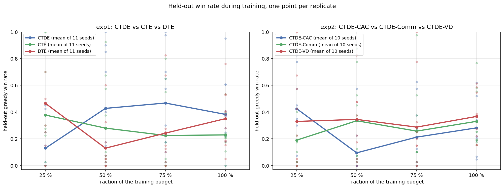
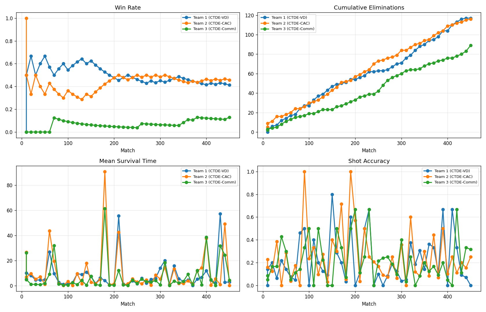

# 8. Results

All numbers in this chapter are recomputed from artefacts in the repository, by scripts rather than by
hand. The mapping from section to command is in
[§ Reproducing the numbers](README.md#reproducing-the-numbers); the ones this chapter depends on are
`scripts/report_study.py` (every study table, the paired *t* and Fisher tests, and the forward-power
table), `scripts/plot_study.py` (`results/study/learning_curves.png`), `scripts/random_baseline.py`
([§ 8.9](#random-baseline)), `scripts/run_cross_arena.py` + `scripts/report_cross_arena.py`
([§ 8.10](#cross-arena)), `scripts/run_absolute_eval.py` ([§ 8.11](#absolute-strength)),
`scripts/run_study.py` again for the arena-v2 and ablation campaigns ([§ 8.12](#arena-v2),
[§ 8.13](#ablations)) and `scripts/report_study.py --compare-to` for the paired arm tables. The
leave-one-out table in [§ 8.1](#leave-one-out) calls
`report_study.paired_t` on the same per-seed matrix with one replicate dropped, so it is not a second
statistics implementation.

The chapter has two halves, and they are **not** interchangeable:

* **[§ 8.1 Replicated study](#replicated-study)** — 10 independent replicates per experiment at 500,000
  steps, measured by held-out greedy evaluation of the final policy, produced under the corrected heading
  controller with the paradigm-to-slot assignment rotated across seeds. This is the primary evidence.
* **[§ 8.2 Historical single-seed runs](#historical-single-seed-runs)** — the two 100,000-step runs the
  repository originally shipped: one seed, measured during training, under the defective control law
  [A-1](11_code_audit.md#turn-control-defect) before it was fixed. Kept because those artefacts are what
  `data/` contains, and because the study **contradicts** their headline conclusion — which is the most
  important result in this document.

---

## 8.1 Replicated study <a name="replicated-study"></a>

### Design

| | |
|---|---|
| Replicates | 10 seeds × 2 experiments = 20 runs, all completed, no failures |
| Budget per replicate | 500,000 environment steps (5× the historical runs, half of the superseded 5-seed study) |
| Seeds | 1–10, controlling the `random`, NumPy and Torch streams |
| Slot rotation | `paradigm_rotation = seed % 3`, so each paradigm occupies each team slot 6 or 7 times across the 20 runs (observed: rotation 0 × 6, 1 × 8, 2 × 6) |
| Initialisation | fresh — `ARENA_DATA_DIR` isolates each run, so no checkpoint warm-start |
| Training-time metric records | every 100 matches; 87,863 training matches played in total |
| Held-out evaluation | 150 greedy matches on the final policy, plus 60 at each of 25/50/75/100 % |
| Evaluation conditions | `domain_randomization=False`, `set_rl_training(False)`, separate simulation instance |
| Trials per paradigm | 1,500 held-out matches (10 seeds × 150) |
| Wall clock | 117.5 min for all 20 replicates, run concurrently on 32 cores |
| Cost | 31.5 CPU-hours training + 4.7 h evaluation = **36.2 CPU-hours** |
| Throughput | 82.6–92.9 steps/s per process under 20-way load (368 steps/s alone) |

The budget was halved from the superseded 5-seed study in order to double the number of independent
replicates at a slightly lower total cost; with a between-seed SD near 0.2 and a per-seed standard error of
only ~0.04, replicate count is the binding constraint, not step count. That decision is revisited in
[§ 8.1 Power](#power-analysis) — at the effect sizes actually observed, neither lever is close to enough.

Held-out win rate is the response variable throughout. The training-time running average appears only in
[§ 8.2](#historical-single-seed-runs).

### Experiment 1 — CTE vs DTE vs CTDE

| Paradigm | Mean win rate over seeds | Between-seed SD | Pooled wins | Pooled 95 % CI | Elim./match | Survival (s) | Shots/match | Shots per alive-second | Accuracy |
|---|---:|---:|---:|---|---:|---:|---:|---:|---:|
| **DTE** | **0.381** | 0.191 | 571/1500 | [0.356, 0.406] | 1.95 | 24.98 | 105.2 | 1.404 | 2.71 % |
| CTDE | 0.326 | 0.187 | 489/1500 | [0.303, 0.350] | 1.97 | 18.37 | 101.2 | 1.835 | 2.65 % |
| CTE | 0.252 | 0.122 | 378/1500 | [0.231, 0.275] | 2.22 | 22.69 | 121.7 | 1.788 | 3.59 % |

Per-seed held-out win rate — each column is one independent replicate:

| Paradigm | s1 | s2 | s3 | s4 | s5 | s6 | s7 | s8 | s9 | s10 | best in |
|---|---:|---:|---:|---:|---:|---:|---:|---:|---:|---:|---:|
| DTE | 0.153 | 0.527 | 0.280 | 0.187 | 0.533 | **0.760** | 0.180 | 0.400 | 0.407 | 0.380 | 6/10 |
| CTDE | **0.607** | 0.220 | **0.607** | 0.280 | 0.247 | **0.000** | 0.407 | 0.180 | 0.347 | 0.367 | 3/10 |
| CTE | 0.207 | 0.240 | 0.107 | **0.533** | 0.207 | 0.213 | 0.393 | 0.173 | 0.227 | 0.220 | 1/10 |

Seed-level paired tests (n = 10 replicates; the seed is the independent unit):

| Comparison | Mean per-seed difference | SD of difference | Paired *t* | *p* (df = 9) | Verdict |
|---|---:|---:|---:|---:|---|
| CTDE vs CTE | +0.074 | 0.236 | +0.99 | 0.348 | not significant |
| CTDE vs DTE | −0.055 | 0.357 | −0.48 | 0.640 | not significant |
| CTE vs DTE | −0.129 | 0.265 | −1.54 | 0.158 | not significant |

Match-level Fisher exact tests on the pooled 1,500 held-out matches per paradigm:

| Comparison | Wins / matches | Odds ratio | *p* (two-sided) |
|---|---|---:|---:|
| CTDE vs CTE | 489/1500 vs 378/1500 | 1.44 | 9 × 10⁻⁶ |
| CTDE vs DTE | 489/1500 vs 571/1500 | 0.79 | 0.0020 |
| CTE vs DTE | 378/1500 vs 571/1500 | 0.55 | < 10⁻⁴ |

> **The two test levels still disagree completely, and the seed-level one is the correct one.** Treating
> 1,500 matches as independent trials makes every exp-1 comparison significant; treating the 10 replicates
> as the independent unit makes none of them significant. Doubling the replicate count and adding slot
> rotation did not change that — it changed the *estimates*, not the *variance structure*. Matches within a
> replicate are not independent draws: they are played by one frozen policy against two others from the same
> run, sharing that run's initialisation, geometry stream and opponent dynamics. The match-level *p* values
> are anti-conservative and are shown only to make the size of that assumption visible.

### Experiment 2 — CTDE-VD vs CTDE-CAC vs CTDE-Comm

| Paradigm | Mean win rate over seeds | Between-seed SD | Pooled wins | Pooled 95 % CI | Elim./match | Survival (s) | Shots/match | Shots per alive-second | Accuracy |
|---|---:|---:|---:|---|---:|---:|---:|---:|---:|
| **CTDE-VD** | **0.367** | 0.171 | 551/1500 | [0.343, 0.392] | 1.97 | 23.08 | 92.8 | 1.340 | 3.01 % |
| CTDE-Comm | 0.331 | 0.218 | 496/1500 | [0.307, 0.355] | 2.18 | 19.23 | 111.6 | 1.935 | 2.40 % |
| CTDE-CAC | 0.282 | 0.182 | 423/1500 | [0.260, 0.305] | 1.98 | 21.47 | 112.3 | 1.744 | 2.35 % |

Per-seed held-out win rate:

| Paradigm | s1 | s2 | s3 | s4 | s5 | s6 | s7 | s8 | s9 | s10 | best in |
|---|---:|---:|---:|---:|---:|---:|---:|---:|---:|---:|---:|
| CTDE-VD | 0.387 | 0.367 | 0.153 | **0.547** | 0.220 | 0.153 | 0.373 | 0.273 | **0.613** | **0.587** | 5/10 |
| CTDE-Comm | 0.253 | 0.253 | **0.553** | 0.173 | 0.153 | **0.767** | **0.580** | 0.193 | 0.187 | 0.193 | 3/10 |
| CTDE-CAC | 0.340 | 0.333 | 0.280 | 0.220 | **0.620** | 0.067 | 0.047 | **0.520** | 0.187 | 0.207 | 2/10 |

Seed-level paired tests:

| Comparison | Mean per-seed difference | SD | Paired *t* | *p* (df = 9) | Verdict |
|---|---:|---:|---:|---:|---|
| CTDE-CAC vs CTDE-Comm | −0.049 | 0.360 | −0.43 | 0.679 | not significant |
| CTDE-CAC vs CTDE-VD | −0.085 | 0.282 | −0.96 | 0.363 | not significant |
| CTDE-Comm vs CTDE-VD | −0.037 | 0.347 | −0.33 | 0.746 | not significant |

Match-level Fisher tests: CAC vs Comm *p* = 0.0043, CAC vs VD *p* < 10⁻⁴, Comm vs VD *p* = 0.0386 — two of
the three pass Bonferroni at the match level and none come close to it at the seed level.

### One replicate is enough to reverse the exp-1 ranking <a name="leave-one-out"></a>

The exp-1 per-seed matrix contains one extreme replicate: **seed 6's CTDE arm scores 0.000 under greedy
evaluation.** Over its 150 held-out matches it fired 3.8 shots per match against 325 and 372 for the other
two teams, recorded 0.01 eliminations per match, and won nothing — a zero on a 1/3 chance baseline. It is
the only such cell in 60 paradigm-seed evaluations (threshold: held-out eliminations below 0.25 per match),
and it is what drags CTDE's mean from 0.362 to 0.326.

**It is not a training collapse, and an earlier draft of this section said it was.** The same policy, read
through the stochastic action sampler it was actually trained with, was the *best* arm of that run:

| seed 6, CTDE | during training (4,929 matches, sampled actions) | held out (150 matches, greedy actions) |
|---|---:|---:|
| win rate | 0.315 | 0.000 |
| eliminations per match | **2.68** (highest of the three arms) | 0.01 |
| shot accuracy | **0.1041** (highest of the three arms) | 0.0018 |
| mean survival | 4.84 s | 9.3 s |

So the policy learned to fight — it led its own match in kills and accuracy — and the held-out protocol turns
it into something that never fires. **Which part of that protocol is responsible has now been measured, and it
is not the argmax.** Replayed on the same checkpoint, the same seed and the same 150 matches, this cell reads
0.000 with 3.8 shots per match under greedy, 0.020 with 7.3 shots at T = 0.5 and 0.020 with 8.0 shots at
T = 1 ([§ Readout re-measured](#readout-re-measured)) — an order of magnitude below the 325 and 372 its
opponents fire, under every action rule. What separates this row from the training column is therefore
*evaluation against fixed opponents in a randomisation-off arena*, not the choice between sampling and argmax.
The readout divergence is real and it moves levels and orderings — but it does not explain this collapse, and
an earlier version of this paragraph claimed it did.

Recomputing exp 1 with that one replicate removed, using the same shipped `paired_t`:

| Comparison | n = 10 | n = 9 (seed 6 removed) |
|---|---|---|
| CTDE mean win rate | 0.326 (2nd) | **0.362 (1st)** |
| DTE mean win rate | 0.381 (1st) | 0.339 (2nd) |
| CTDE vs CTE | +0.074, *t* = +0.99, *p* = 0.348 | +0.106, *t* = +1.40, *p* = 0.199 |
| CTDE vs DTE | −0.055, *t* = −0.48, *p* = 0.640 | +0.024, *t* = +0.26, *p* = 0.801 |
| CTE vs DTE | −0.129, *t* = −1.54, *p* = 0.158 | −0.082, *t* = −1.06, *p* = 0.322 |

**A single replicate out of thirty paradigm-slots flips which architecture is reported as the winner**, in
both the mean ordering and the sign of the paired difference, while nothing reaches significance either
way. The exp-1 ranking is therefore not a finding of this study; the divergence that produced the extreme
cell is, and it is a property of the measurement rather than of the optimiser.

### The readout diverges from the trained policy <a name="readout-divergence"></a>

The study's response variable is held-out **greedy** win rate, on the argument that a deployed policy should
be measured deterministically. That choice is defensible; treating the resulting numbers as a measurement of
*what training produced* is not. Across all 60 arm-replicate cells:

| | mean | SD | min | max |
|---|---:|---:|---:|---:|
| Win rate during training (sampled actions) | 0.331 | **0.072** | 0.176 | 0.464 |
| Held-out win rate (greedy actions) | 0.323 | **0.177** | 0.000 | 0.767 |

Two things follow. The greedy readout has **2.5× the spread** of the behaviour that was actually optimised,
so most of the variance this study had to fight is introduced at measurement time. And the orderings
disagree: across the 59 comparable within-replicate pairs, the greedy ranking matches the training ranking
in **21 — 35.6 %, worse than a coin flip.**

The largest single divergences are not marginal either:

| cell | training win rate | greedy win rate |
|---|---:|---:|
| exp-2 seed 7, CTDE-CAC | 0.390 | 0.047 |
| exp-2 seed 5, CTDE-CAC | 0.271 | 0.620 |
| exp-1 seed 4, CTE | 0.176 | 0.533 |
| exp-2 seed 6, CTDE-Comm | 0.271 | 0.767 |

This does not invalidate the study's null result — a measurement with more noise cannot detect an effect, and
the conclusion was that no effect is detectable. It does relocate part of the main finding: **the architecture
differences this repository spent two campaigns chasing are the same size as the shift produced by changing
how the same frozen network picks an action** — experiment 2's spread across its three arms is 0.085 under
argmax, and the readout moves individual arms by up to 0.044, enough to reorder them. The sentence this
section used to end with — "fix the readout before adding replicates" — has now been tested rather than
followed, and it needs both halves: dual-reporting the readout is necessary for interpretation and useless
for power ([§ below](#readout-re-measured)).

**The remedy is now an instrument, and the tables above stay the greedy arm; the sampled re-measurement is the
subsection that follows.** `EVAL_TEMPERATURE`
(§ 7.6, point 11) switches the held-out readout from argmax to a fixed-temperature sample of the same
network's logits, and `scripts/eval_readout.py` replays a trained replicate under both without touching its
weights — the protocol is copied from the study's own held-out evaluation and pinned by
`tests/test_readout_parity.py`, with the same run directory, the same `seed + 9000` stream, the same fixed
variant and the same 150 matches, so the two arms differ only in the action rule. `--temperature 0` is the
control: its difference from `results/study/` is what re-measurement noise alone amounts to, which is the
yardstick every temperature row should be read against. `--checkpoint-set versioned` reads the versioned
blocks instead of this machine's scratch, which is what makes the re-measurement runnable from a clone — and
each experiment must be evaluated by the tree that trained it, a boundary the harness enforces because a
same-shaped state dict loads into the wrong architecture without complaint.
`scripts/run_readout_campaign.sh` plays all twenty
replicates at T = 0, 0.5 and 1. That campaign has run — 27,000 matches, 4 h 43 min of wall clock, in
`results/readout/` — and the sampled win rates are below. The 2.5× spread and 35.6 % agreement above stay in
print because they are measured from a different source: the traces the training runs wrote themselves, not
a re-evaluation.

### What the same networks do when the readout is not argmax <a name="readout-re-measured"></a>

**The control is exact, which is what makes the rest readable.** Replaying all sixty cells at T = 0 — the
same checkpoints, the same `seed + 9000` stream, the same 150 matches, argmax as published — reproduced
`results/study/` on **every cell to the last decimal**: paired difference +0.000, *p* = 1.000, and every
behavioural column (survival, eliminations, shots, accuracy) identical. Re-measurement noise is therefore
zero on this instrument, and any difference in the two sampled arms is the action rule and nothing else.
The campaign read the study's own scratch runs (`checkpoint_set: scratch` in each arm's `summary.json`), and
all sixty of those checkpoints have a byte-identical twin under `data/training_replicates/`, so
`--checkpoint-set versioned` reproduces the same numbers from a clone rather than only from this machine.

| Experiment / architecture | argmax (published) | T = 0 (control) | T = 0.5 | T = 1 |
|---|---:|---:|---:|---:|
| exp1 DTE | 0.381 | 0.381 | 0.379 | 0.372 |
| exp1 CTDE | 0.326 | 0.326 | 0.337 | 0.353 |
| exp1 CTE | 0.252 | 0.252 | 0.255 | 0.255 |
| exp2 CTDE-VD | **0.367** | 0.367 | 0.323 | 0.331 |
| exp2 CTDE-Comm | 0.331 | 0.331 | 0.331 | **0.346** |
| exp2 CTDE-CAC | 0.282 | 0.282 | 0.325 | 0.314 |

Four things follow, and the first two are the ones that change what this repository is allowed to say.

1. **Experiment 1's ordering is readout-invariant; experiment 2's is not.** DTE > CTDE > CTE in all four
   columns, though the DTE–CTDE gap shrinks from 0.055 to 0.019 at T = 1 (*p* = 0.635 paired against the
   control). In experiment 2 the architecture that wins *depends on how it is asked*: CTDE-VD is first under
   argmax, **last** at T = 0.5 and second at T = 1, while CTDE-CAC moves from 0.282 to 0.325 (+0.043,
   *p* = 0.020) and CTDE-VD loses −0.044 (*p* = 0.051). Those are the only two cells in the whole study whose
   readout shift reaches an uncorrected 0.05 — and neither survives the study's own Bonferroni threshold of
   0.0167, so the honest statement is not "sampling makes CAC best" but "**VD's first place in experiment 2
   is a property of the argmax readout**".
2. **Sampling does not buy precision.** Between-seed SD over the six architectures is 0.129–0.220 at
   T = 0.5 and 0.128–0.199 at T = 1, against **0.122–0.218** under argmax — the same spread, if anything a
   hair wider: the replicate-to-replicate variance is the training variance, and it is untouched by how the
   actions are selected. In experiment 2 alone the bands are 0.171–0.218 greedy, 0.170–0.220 and 0.164–0.199
   sampled. The forward power at T = 0.5 for the observed experiment-2
   differences is ~18,000 to ~240,000 replicates. The 2.5× figure above was about the *within-replicate*
   distribution versus the training trace, and this section's remedy — fix or dual-report the readout — is
   now measured as necessary for interpretation and useless for power.
3. **Behaviour moves monotonically with temperature, and the win rate does not follow it.** Taking exp1 CTDE
   as the column: shots per match 101 → 82 → 63, shot accuracy 2.65 % → 3.90 % → 4.60 %, eliminations per
   match 1.97 → 2.01 → 2.12, mean survival 18.4 → 15.2 → 11.6 s. The sampled policy fires less, hits more,
   kills slightly more, dies noticeably sooner, and wins about the same amount. That is the mechanism behind
   the divergence: argmax commits every step to the modal action, which is a firing pattern the training
   distribution only sometimes visits.
4. **The null result is now supported by two readouts.** At both temperatures, every within-experiment paired
   comparison in both experiments is not significant (all *p* ≥ 0.197 in experiment 1, all ≥ 0.942 at
   T = 0.5 and ≥ 0.770 at T = 1 in experiment 2, seed-level). The study's conclusion that these architectures
   do not separate was drawn from the greedy arm; it does not become a different conclusion when the same
   networks are asked stochastically.


### What the optimiser's own trace says about the readout <a name="traces-measured"></a>

The audit's open-work item 4 has asked since the first pass whether a replicate that collapses under the
held-out readout looks different from the inside — whether a KL or entropy trace would have flagged the
seed-6 arm two campaigns before anyone noticed it. The traces did not exist for the study's replicates, so
the twenty were re-trained with the capture in place, and the re-training first had to prove it was the same
training. It did: **all 60 produced checkpoints hash-match `data/training_replicates/`**, and the re-trained
held-out rates equal the published ones to at most 3.3e-05 (mean 2.3e-05, which is the CSV's rounding). 20
runs, 500 k steps, 134.8 min of wall clock at 20-way concurrency, nothing committed but the analysis.

Then the answer, and it is a negative one. Spearman correlations across the 60 arm-replicate cells:

| Feature | ρ vs held-out | *p* | ρ vs in-training | ρ vs the signed gap | *p* |
|---|---:|---:|---:|---:|---:|
| entropy, final | **−0.361** | 0.0043 | +0.069 | −0.270 | 0.0365 |
| entropy, mean over the run | −0.303 | 0.0181 | +0.136 | −0.247 | 0.0565 |
| `approx_kl`, mean | −0.271 | 0.0355 | −0.173 | −0.153 | 0.2431 |
| `approx_kl`, final | −0.271 | 0.0361 | −0.136 | −0.137 | 0.2963 |
| value loss, final | +0.113 | 0.3921 | +0.196 | −0.030 | 0.8214 |
| value loss, mean | −0.090 | 0.4942 | **+0.539** | −0.276 | 0.0324 |
| `approx_kl`, maximum | −0.037 | 0.7776 | −0.318 | +0.121 | 0.3587 |
| policy loss, final | +0.024 | 0.8585 | +0.250 | −0.129 | 0.3262 |

**Nothing here survives the 96 tests it comes from** (Bonferroni alpha = 0.00156; the smallest *p* is 0.0043),
and the strongest cell-level number disappears when the unit of analysis is corrected to the run: three arms
inside a run share its RNG stream, its opponents and its match history, so 60 cells are 20 independent draws
with three readings each. At run level, entropy_final is **+0.119** (*p* = 0.62), entropy_mean −0.088, and
`approx_kl` mean −0.332 (*p* = 0.155) — with the sign of the final-KL reading flipping between the two units,
which is what a within-run artefact looks like. The one number that does survive correction, value loss
against the *in-training* win rate (+0.539, *p* = 5e-06), is mechanical rather than predictive: a team that
wins more collects return variance for its critic to chase, in the same matches that produced both numbers,
and it does not carry over to the held-out read (−0.090).

The seed-6 case can now be answered directly instead of by inference. Its trace is unremarkable: final
entropy 0.509 against a field median of 0.459 (**rank 33 of 60**), mean KL 0.0027 (rank 24), mean value loss
0.587 (rank 31), and its maximum KL 0.0255 sits in the lowest octile (rank 8) — the runs with the largest KL
spikes are not the ones that collapsed. A KL guard watching this run would have seen an ordinary optimisation
and said nothing. That is the same conclusion the sampled-readout re-measurement reached from the other
direction ([§ Readout re-measured](#readout-re-measured)): the collapse is a property of evaluating a frozen
policy against fixed opponents with randomisation off, not of what happened during training, and no optimiser
instrument would have caught it.

One property of the estimator deserves a note before anyone graphs these columns: `approx_kl` here is
`mean(old_log_prob − new_log_prob)`, a signed log-ratio rather than a non-negative divergence estimate, so it
goes negative — the field minimum is −0.0042 — and that is the estimator behaving as written, not a defect
([A-14](11_code_audit.md#approx-kl-placeholder) is about the field being hard-coded to zero, which it no
longer is).

### Two regimes: wipeouts and timeouts <a name="two-regimes"></a>

Held-out median match duration is bimodal across replicates, not noisy around a mean:

| Regime | Replicates | Held-out median duration |
|---|---:|---|
| Matches end in a wipeout | 15 of 20 | 6.9 – 20.4 s |
| Matches run to the 90 s cap | 5 of 20 | 90.1 s (exp 1 seeds 6, 8; exp 2 seeds 2, 4, 9) |

Draws — every team alive with equal eliminations at the cap, under the [A-10](11_code_audit.md) tie-break —
occur in 62/1500 (4.1 %) of exp-1 held-out matches and 30/1500 (2.0 %) of exp-2 matches. Seed 6 is the same
replicate that produced the CTDE collapse: with one team not shooting, the other two spray (325 and 372
shots per match at 0.5–0.8 % accuracy), nobody dies, and matches end on the clock rather than on a kill.
Win rates measured in that regime are answering "who is most alive after 90 s", which is a different
question from "who wins a fight" — a further reason not to read the exp-1 ordering as a result.

### The historical conclusions do not survive <a name="reversal"></a>

| | Historical (1 seed, training-time, broken control law) | Study (10 seeds, held-out, fixed control law, rotated slots) |
|---|---|---|
| **Exp. 1 order** | CTDE 47.2 % > CTE 27.4 % > DTE 25.4 % | **DTE 38.1 % > CTDE 32.6 % > CTE 25.2 %** |
| **Exp. 2 order** | CAC 42.9 % > VD 40.7 % ≫ **Comm 16.4 %** | **VD 36.7 % > Comm 33.1 % > CAC 28.2 %** |
| The one defended finding | "Comm loses to both others" | **does not reproduce** — Comm is now 2nd of 3 |
| The exp-2 winner | CAC, by 2 points over VD | **CAC, by 8 points, last** |

Both experiments reverse, and the exp-2 reversal is more complete than the one reported by the superseded
5-seed study: CTDE-CAC was the historical winner and is now the last-place arm, while CTDE-Comm went from
last by 26 points to middle. CTDE-VD's per-seed results span 0.153 to 0.613 and CAC's span 0.047 to 0.620 —
each architecture produced one of the two best *and* one of the two worst replicates in its own experiment.

Two readings are possible and this data cannot separate them:

1. **The original findings were artefacts of the broken turn controller.** Under
   [A-1](11_code_audit.md#turn-control-defect) agents spun toward a fixed absolute heading rather than
   toward their waypoint. A communication channel built from relative-position features would be
   especially damaged by an actuator that cannot steer toward what it computes.
2. **They were single-seed flukes**, for which the per-seed matrices above show ample room: a spread from
   0.047 to 0.767 within one architecture makes any one-seed ranking fragile.

Both readings imply the same operational conclusion: **the historical rankings were not properties of the
architectures.**

### Learning curves



*Mean over 10 replicates (thick line) with every individual replicate shown (pale points). The dashed line
is the 1/3 three-way chance level. Curve points are held-out greedy evaluations of intermediate checkpoints,
so unlike the historical training-time metrics they are comparable across fractions.*

| Paradigm | 25 % | 50 % | 75 % | 100 % | Change 25 → 100 |
|---|---:|---:|---:|---:|---:|
| **Exp. 1** DTE | 0.465 | 0.130 | 0.243 | 0.351 | −0.114 |
| CTDE | 0.130 | 0.427 | 0.467 | 0.383 | +0.253 |
| CTE | 0.378 | 0.280 | 0.225 | 0.229 | −0.148 |
| **Exp. 2** CTDE-VD | 0.330 | 0.345 | 0.287 | 0.367 | +0.037 |
| CTDE-Comm | 0.190 | 0.335 | 0.258 | 0.331 | +0.141 |
| CTDE-CAC | 0.425 | 0.095 | 0.212 | 0.282 | −0.143 |

The 100 % column is the 60-match curve point, not the 150-match final evaluation, so it differs from the
headline means in the tables above by sampling noise (e.g. exp-1 CTDE: 0.383 here, 0.326 there). Each point
is 60 matches per replicate, giving a per-point binomial SE near 0.06 and an SE of the 10-replicate mean near
0.02 *if* replicates agreed; they do not, and the between-replicate spread dominates by roughly an order of
magnitude.

No curve is monotone. Three of six arms are best at the *earliest* checkpoint (DTE 0.465 at 25 %, CTE 0.378
at 25 %, CAC 0.425 at 25 %) and finish lower, which is what a degenerate-basin process looks like: early
policies are near-uniform and lose to each other in varied ways, then some runs settle into a fixed
attractor.

> **The project's central hypothesis about communication is still not supported, in a new way.** The claim —
> inherited from the original README — was that CTDE-Comm needs more steps than the others because messages
> must become informative before they help. In the 5-seed study Comm was *worst* at 25 % (0.650) and drifted
> down. With 10 replicates it is *worst* again at 25 % (0.190) but now drifts **up** (+0.141) — the sign of
> the trajectory flipped when the replicate count changed, which is itself the answer: the curve shape is
> not a property of the architecture. The one stable statement is the negative one: at 500,000 steps,
> Comm's advantage is not the monotone growth the hypothesis predicts, and VD's is barely any growth at all
> (+0.037).

### Component metrics moved far more than the ranking <a name="component-metrics-moved-far-more-than-the-ranking"></a>

Comparing the study to the historical run is confounded by the control-law fix, and the scale of the confound
is directly visible:

| Quantity | Historical runs | Replicated study |
|---|---:|---:|
| Shots per match | 21 – 27 | 92.8 – 121.7 |
| Shot accuracy | 8.1 – 12.8 % | 2.35 – 3.59 % |
| Mean survival | 7.5 – 10.2 s | 18.4 – 25.0 s |
| Eliminations per match | 1.7 – 3.4 | 1.95 – 2.22 |

Fixing the heading controller made agents drive at their waypoints, which put them in weapon range far more
often: they fire roughly four times as much and convert far less per shot, while surviving twice as long.
**The arena these architectures competed in is not the same arena as before**, which is why the historical
numbers are labelled as such rather than compared directly.

The identity of [§ 8.4](#metric-rank-deficiency) — eliminations = shots × accuracy — still holds, but only
**within** a replicate. It does not hold for the *mean* of per-seed ratios, which is what the tables above
report, because per-seed shot counts vary by more than 80× (3.8 to 372.4 shots per match).

### Firing volume per unit of alive life <a name="firing-rate"></a>

Every table above reports shots per match, and a shot needs an agent that is standing: an arm eliminated in
the first seconds cannot accumulate volume, so the raw column answers "who shoots less" and "who dies sooner"
with the same number. The experiment-2 open-work list asked for the ratio that separates them; the ratio is
`shots per match / (3 x mean survival)`, where the factor 3 is the team's three agents and `survival` is
accrued only while an agent is alive (`simulation.py` adds `dt` to `agent.survival_time` inside the alive
branch, and reports the mean over the team). No new measurement was needed — both columns are already in
`results/study/per_seed_metrics.csv` — so this is arithmetic over the committed study, added to
`report_study.py`, `report_cross_arena.py` and `run_cross_arena.py`.

| Architecture | Shots / match | Mean survival (s) | Shots per alive-second |
|---|---:|---:|---:|
| exp1 CTDE | 101.2 | 18.37 | **1.835** |
| exp1 CTE | 121.7 | 22.69 | 1.788 |
| exp1 DTE | 105.2 | 24.98 | 1.404 |
| exp2 CTDE-Comm | 111.6 | 19.23 | **1.935** |
| exp2 CTDE-CAC | 112.3 | 21.47 | 1.744 |
| exp2 CTDE-VD | 92.8 | 23.08 | 1.340 |
| round-robin Comm | 115.8 | 20.0 | 1.93 |
| round-robin CTDE | 98.1 | 18.9 | 1.73 |
| round-robin CTE | 96.0 | 19.3 | 1.66 |
| round-robin VD | 97.6 | 22.0 | 1.48 |
| round-robin CAC | 93.6 | 21.7 | 1.44 |
| round-robin DTE | 97.1 | 22.8 | 1.42 |

Three things the unnormalised column could not say:

1. **CTDE-Comm's restraint is not a survival artefact — the opposite.** In the study, Comm and CAC fire
   statistically the same volume (111.6 against 112.3 shots) while Comm lives 2.2 s less per agent, so per unit
   of alive life Comm fires 11 % more. Comm is the most aggressive arm on this scale in both instruments
   (1.935 in the study, 1.93 on the common pool) and it is also the pooled round-robin's winner — the two
   readings agree on which arm shoots most *given the time it had*.
2. **The study's experiment-1 winner is the least trigger-happy arm, and the difference the raw column hides
   is a factor of 1.3.** DTE fires 105.2 shots like everyone else, but spread over the longest alive life
   (24.98 s) it is last at 1.404, against CTDE's 1.835 in the shortest (18.37 s). Read raw, CTE looks like the
   shooter (121.7 shots) and DTE like the patient one; normalised, most of CTE's extra volume is the extra
   4.3 s it spends standing, and its rate (1.788) lands beside CTDE's rather than above it.
3. **Volume and outcome are not on the same axis.** In experiment 1 the arm with the best win rate fires the
   least per alive second (DTE, 0.381 and 1.404) and the second-best fires the most (CTDE, 0.326 and 1.835);
   across the three arms the two orderings have Spearman −0.5. Combined with an accuracy of 2–4 %
   ([§ 8.4](#metric-rank-deficiency)), firing rate describes engagement style here, not the axis the ranking
   runs along — and no claim in this document depends on it.

**Aggregation convention.** The instrument computes the ratio of the two *means*, not the mean of the per-seed
ratios — the same distinction [§ 8.1](#component-metrics-moved-far-more-than-the-ranking) makes about the
elimination identity. The ordering is invariant between the two here (checked: mean-of-ratios gives
1.708 / 1.664 / 1.499 for experiment 1 and 1.913 / 1.801 / 1.493 for experiment 2, same ranks as the ratio of
means), so no conclusion rests on the choice; the numbers quoted above are the instrument's own.

### Power: how many replicates this would take <a name="power-analysis"></a>

Computed by `scripts/report_study.py` from the observed paired differences and their spread, for two-sided
α = 0.0167 (Bonferroni over three comparisons) at 80 % power, using the self-consistent
n = ((t<sub>crit</sub> + t<sub>β</sub>)·SD / mean)² solve. The solver was checked against a noncentral-*t*
power computation over the six observed pairs and agrees within one replicate everywhere.

| Comparison | Observed difference | SD of difference | Cohen *d* | Replicates needed |
|---|---:|---:|---:|---:|
| Exp. 1 CTDE vs CTE | +0.074 | 0.236 | +0.313 | ~110 |
| Exp. 1 CTDE vs DTE | −0.055 | 0.357 | −0.153 | ~450 |
| Exp. 1 CTE vs DTE | −0.129 | 0.265 | −0.486 | ~47 |
| Exp. 2 CAC vs Comm | −0.049 | 0.360 | −0.135 | ~576 |
| Exp. 2 CAC vs VD | −0.085 | 0.282 | −0.303 | ~117 |
| Exp. 2 Comm vs VD | −0.037 | 0.347 | −0.106 | ~939 |

These numbers are **five to sixty times larger** than those the 5-seed study reported (~13, ~49, ~91, ~272,
~421). That is not a mistake: doubling the replicates shrank the observed differences far faster than it
shrank their spread, so the effect sizes moved away from detectability as the estimates got better. This is
the characteristic signature of chasing a noise-dominated quantity.

At 1.8 CPU-hours per replicate, the cheapest comparison (CTE vs DTE, ~47 replicates) costs about **85
CPU-hours**, roughly 90 min of wall clock at 20-way concurrency — affordable. The exp-2 comparisons cost
100–1,700 CPU-hours. But the leave-one-out result above says a ranking that swings on a single degenerate
replicate is not a thing that more replicates would resolve: the next 100 replicates would add more collapses,
not less. The fix that would actually change this is to the *reward and termination design*, not to the
sample size.

---

## 8.2 Historical single-seed runs <a name="historical-single-seed-runs"></a>

Everything from here on describes the two original 100,000-step runs. It is retained because those
artefacts ship in `data/`, and because the analyses below are what justified re-running everything — but
their conclusions are superseded by [§ 8.1](#replicated-study).

### Experiment 1 — CTE vs DTE vs CTDE

Source: `data/metrics/summary.json` (463 matches played; snapshot taken at match 460).

| Team | Paradigm | Win rate | Elim./match | Mean survival (s) | Shot accuracy | Hits | Misses |
|---|---|---:|---:|---:|---:|---:|---:|
| Team 1 | CTE | 27.39 % | 1.72 | 9.63 | 8.10 % | 790 | 8,959 |
| Team 2 | DTE | 25.43 % | 1.84 | 8.59 | 8.13 % | 848 | 9,587 |
| Team 3 | **CTDE** | **47.17 %** | **3.42** | **9.93** | **12.84 %** | 1,571 | 10,663 |

### Experiment 2 — CTDE-VD vs CTDE-CAC vs CTDE-Comm

Source: [`ctde_arena/data/metrics/summary.json`](../ctde_arena/data/metrics/summary.json) (456 matches
played; snapshot at match 450).

| Team | Paradigm | Win rate | Elim./match | Mean survival (s) | Shot accuracy | Hits | Misses |
|---|---|---:|---:|---:|---:|---:|---:|
| Team 1 | CTDE-VD | 40.67 % | 2.50 | 10.20 | 11.29 % | 1,125 | 8,843 |
| Team 2 | **CTDE-CAC** | **42.89 %** | **2.63** | 9.83 | **12.33 %** | 1,184 | 8,417 |
| Team 3 | CTDE-Comm | 16.44 % | 1.96 | 7.47 | 12.14 % | 883 | 6,390 |



*The four-panel dashboard regenerated from the versioned `team_match_metrics.csv`. The win-rate panel is a
**cumulative** ratio over recorded matches only, so the visible convergence near 0.41/0.43 is regression
to the mean of a 46-sample estimate, not a training effect.*

## 8.3 Analyses performed on the historical data <a name="historical-analyses"></a>

The following sections were the diagnostic work that motivated the study. Each is a correct analysis of the
historical artefacts, and each found something the study then overturned or recontextualised.

## 8.4 The metric set is rank-deficient <a name="metric-rank-deficiency"></a>

`eliminations_per_match` is not an independent measurement. Because every hit eliminates exactly one agent
and every elimination comes from a hit,

\[
\text{elim/match} \;=\; \text{shots/match} \times \text{shot accuracy}
\]

holds to the reported precision for all six historical teams (verified: CTE \(21.19 \times 0.0810 = 1.72\)
against a reported 1.72; CTDE-Comm \(16.16 \times 0.1214 = 1.96\) against 1.96). Four headline columns
therefore carry three degrees of freedom, and any interpretation treating "eliminations" and "accuracy" as
separate evidence double-counts. The identity also holds within each replicate of the study
([§ 8.1](#component-metrics-moved-far-more-than-the-ranking)).

## 8.5 Decomposing the elimination gap <a name="decomposing-the-elimination-gap"></a>

Expressing each historical team relative to a reference arm separates *how much a team shoots* from *how
well it converts*:

**Experiment 1**, relative to CTE:

| Team | Shot volume | Accuracy | Product |
|---|---:|---:|---:|
| DTE | ×1.070 | ×1.003 | ×1.073 |
| CTDE | ×1.255 | ×1.585 | **×1.989** |

CTDE's advantage was two-factor: it fired 26 % more often **and** converted 59 % better.

**Experiment 2**, relative to CTDE-VD:

| Team | Shot volume | Accuracy | Product |
|---|---:|---:|---:|
| CTDE-CAC | ×0.963 | ×1.093 | ×1.052 |
| CTDE-Comm | **×0.730** | **×1.076** | ×0.785 |

> CTDE-Comm was *not* a worse shot even in the historical run — its accuracy (12.14 %) was marginally
> higher than CTDE-VD's (11.29 %) and within 0.2 points of CTDE-CAC's. Its entire elimination deficit was a
> **firing-volume deficit**: it shot 27 % less often. At CTDE-VD's shot volume with its own accuracy it
> would have produced 2.69 eliminations per match, ahead of both other arms.

That analysis survives the replication in one respect: the mechanism it identified — a policy-level
decision to shoot rather than an aiming deficit — is architectural rather than seed-dependent. What did not
survive is the conclusion that this made Comm the weakest arm.

## 8.6 Statistical significance on 46 matches <a name="statistical-significance-historical"></a>

Computed on the 46 recorded matches per team, the most conservative estimate available from the historical
artefacts (Wilson score intervals, two-proportion *z*-tests).

**Experiment 1**

| Team | Wins / recorded | Win rate | 95 % CI |
|---|---:|---:|---|
| CTE | 14 / 46 | 0.304 | [0.191, 0.448] |
| DTE | 13 / 46 | 0.283 | [0.173, 0.425] |
| CTDE | 19 / 46 | 0.413 | [0.283, 0.557] |

| Comparison | *z* | *p* | Verdict |
|---|---:|---:|---|
| CTE vs DTE | +0.23 | 0.819 | not significant |
| CTE vs CTDE | −1.09 | 0.277 | not significant |
| DTE vs CTDE | −1.31 | 0.189 | not significant |

**Experiment 2**

| Team | Wins / recorded | Win rate | 95 % CI |
|---|---:|---:|---|
| VD | 19 / 46 | 0.413 | [0.283, 0.557] |
| CAC | 21 / 46 | 0.457 | [0.322, 0.598] |
| Comm | 6 / 46 | 0.130 | [0.061, 0.257] |

| Comparison | *z* | *p* | Verdict |
|---|---:|---:|---|
| VD vs CAC | −0.42 | 0.674 | not significant |
| VD vs Comm | +3.05 | 0.002 | significant |
| CAC vs Comm | +3.43 | 0.001 | significant |

### Sensitivity to the independence assumption <a name="independence-sensitivity"></a>

Treating the full cumulative denominators (460 / 450 matches) as independent Bernoulli trials instead makes
every Experiment 1 gap significant at *p* < 10⁻⁵ — a swing of ten orders of magnitude produced by an
assumption choice. That assumption is false: the matches are played by policies that change every match, and
exactly one of three teams wins each, so outcomes are negatively correlated within a match.

This was the clearest internal signal that the historical evidence could not support its conclusions, and it
is what the two-level reporting in [§ 8.1](#replicated-study) resolves properly.

## 8.7 Drift in the historical data: was the ranking a learning effect? <a name="drift"></a>

Splitting each team's 46 recorded matches at the midpoint separates "the architecture is better" from "the
architecture learned to be better".

**Experiment 1** — win rate by segment:

| Team | All 46 | First 23 | Last 23 | Last 10 | Change |
|---|---:|---:|---:|---:|---:|
| CTE | 0.304 | 0.304 | 0.304 | 0.200 | **+0.000** |
| DTE | 0.283 | 0.304 | 0.261 | 0.200 | −0.043 |
| CTDE | 0.413 | 0.391 | 0.435 | 0.600 | +0.043 |

> Experiment 1 showed essentially **no learning trend**: the ordering was already present in the first 23
> recorded matches, which begin at match 10. Either the policies converged within a few thousand steps, or
> the ordering was not a learning effect at all.

**Experiment 2** — win rate by segment:

| Team | All 46 | First 23 | Last 23 | Last 10 | Change |
|---|---:|---:|---:|---:|---:|
| VD | 0.413 | 0.478 | 0.348 | 0.200 | **−0.130** |
| CAC | 0.457 | 0.478 | 0.435 | 0.500 | −0.043 |
| Comm | 0.130 | 0.043 | 0.217 | 0.300 | **+0.174** |

The historical data appeared to support the project's hypothesis here: Comm started worst by a wide margin
and improved the most. The held-out curves in [§ 8.1](#learning-curves) show the opposite sign — Comm starts
best and declines — so this apparent improvement was an artefact of either the broken control law or of
measuring a training-time running average rather than a frozen policy.

## 8.8 What MLflow actually contains <a name="mlflow-content"></a>

The versioned export [`ctde_arena/data/mlflow_export/`](../ctde_arena/data/mlflow_export/) holds the 48
metric points that reached the tracker. The 100,000-step run contributed **one** point, at step 50,793:

| Team | Win rate @50,793 | Final cumulative | Δ |
|---|---:|---:|---:|
| CTDE-VD | 0.4039 | 0.4067 | +0.003 |
| CTDE-CAC | 0.4433 | 0.4289 | −0.014 |
| CTDE-Comm | 0.1527 | 0.1644 | +0.012 |

The mid-training snapshot reproduces the final historical ordering to within 1.4 points, corroborating
§ 8.7's finding that the ranking was established early. The 5,000-step smoke run (`457ce1e8`, logged every
1,000 steps) reaches 0.250 / 0.417 / 0.333 for VD / CAC / Comm by step 3,958 — under 4 % of the budget, a
configuration check rather than a result.

The replicated study does not use MLflow; it writes its own held-out curve to
`data/runs/*/evaluation/run_summary.json`.

## 8.9 Baseline behaviour from random initialisation <a name="random-baseline"></a>

The repository previously quoted a 60-match "random baseline" taken before the control-law fix. That has
been re-measured under the current code with `scripts/random_baseline.py`, 300 headless fixed-variant
matches, and it produced a methodological finding of its own: **there are two different things one can mean
by "untrained", and they disagree about almost everything.**

`set_rl_training(False)` makes `decide()` take `torch.argmax` of the actor's logits, which is the right
selection rule for a trained policy and a misleading one for an untrained network — the argmax of random
weights is close to a constant, so such an agent replays roughly one action instead of sampling across the
eight. The script therefore offers `--policy greedy` (what the harness actually runs) and `--policy uniform`
(actions drawn from the action space, weights ignored). 300 matches each.

**Experiment 1 — CTE / DTE / CTDE**

| | Uniform random | Greedy, untrained | Trained (study mean) |
|---|---:|---:|---:|
| Ended by wipeout | **97.0 %** | 35.7 % | mixed — [§ 8.1](#two-regimes) |
| Hit the 90 s cap / drawn | 2.0 % / 1.0 % | 43.0 % / 21.3 % | 4.1 % drawn |
| Median match duration | 12.6 s | 90.1 s | 6.9 – 90.1 s |
| Survival CTE / DTE / CTDE | 9.4 / 8.1 / 10.3 s | 40.7 / 48.8 / 60.4 s | 22.7 / 25.0 / 18.4 s |
| Shots/match | 43.5 / 37.5 / 43.4 | **4.6 / 6.8 / 82.1** | 121.7 / 105.2 / 101.2 |
| Shot accuracy | 5.1 / 5.9 / 6.2 % | 1.5 / 3.4 / 3.8 % | 3.6 / 2.7 / 2.7 % |
| Win rate | 0.257 / 0.270 / 0.463 | **0.013 / 0.023 / 0.750** | 0.252 / 0.381 / 0.326 |

**Experiment 2 — CTDE-VD / CTDE-CAC / CTDE-Comm**

| | Greedy, untrained | Trained (study mean) |
|---|---:|---:|
| Ended by wipeout | **2.0 %** | mixed — [§ 8.1](#two-regimes) |
| Hit the 90 s cap / drawn | 56.7 % / **41.3 %** | 2.0 % drawn |
| Median match duration | 90.1 s | 6.9 – 90.1 s |
| Survival VD / CAC / Comm | 83.3 / 63.6 / 84.9 s | 23.1 / 21.5 / 19.2 s |
| Shots/match | 358.2 / 88.2 / 397.9 | 92.8 / 112.3 / 111.6 |
| Shot accuracy | **0.10 / 0.10 / 0.20 %** | 3.0 / 2.4 / 2.4 % |
| Win rate | 0.167 / 0.037 / 0.383 | 0.367 / 0.282 / 0.331 |

The uniform column is tree-independent — it never queries a network, so experiment 2's uniform baseline is
the same 300 matches as experiment 1's relabelled, not a second measurement. The greedy column is not: it is
a function of each tree's random initialisations, and the two trees differ there in both degree and kind.

Four conclusions follow, and they are the most load-bearing in this chapter:

1. **Training does something.** Against true random play, trained exp-1 agents survive 2–3× longer (18–25 s
   against 8–10 s), fire 2.4–2.8× more often, and finish matches by elimination instead of running the
   clock. The earlier worry in this section — that trained survival of 16.5–25.6 s looked indistinguishable
   from untrained play — was an artefact of comparing against the *greedy* column, whose 40–85 s survival
   comes from agents that cannot aim, not from agents that fight well.
2. **Training massively improves conversion, but only against the greedy floor.** Exp-2's untrained policies
   shoot 88–398 times per match at 0.1–0.2 % accuracy; trained they shoot 93–112 times at 2.4–3.0 % — a
   15–30× gain in accuracy for a third of the volume. Against *uniform random aiming* (5–6 % accuracy) the
   picture inverts: trained policies convert **worse** while firing more. The learned behaviour is
   engagement and positioning, not marksmanship.
3. **Untrained greedy play already sits in the timeout regime.** 41 % of exp-2's baseline matches are
   three-way draws and 57 % hit the cap, against 2 % of the trained study's. So the timeout behaviour
   described in [§ 8.1](#two-regimes) is not something training created — training reduces it sharply — but
   training does not eliminate it.
4. **The paradigm label predicts firing rate before any learning happens.** Exp-1's untrained CTE fires 4.6
   times per match against CTDE's 82.1, and untrained CTDE wins 75 % of matches. That 18× spread comes only
   from which action each architecture's random argmax happens to favour. Any comparison of these arms'
   *engagement* is therefore partly a comparison of their initialisations, and win rate in this arena cannot
   be interpreted against a chance level of 1/3. Mechanism in
   [A-30](11_code_audit.md#greedy-evaluation-of-an-untrained-network-is-not-random-play).

Regenerate either table with:

```
python scripts/random_baseline.py --matches 300 --policy greedy
python scripts/random_baseline.py --matches 300 --policy uniform
```

## 8.10 Cross-experiment round-robin: all six architectures on one scale <a name="cross-arena"></a>

Everything above compares the three arms of one experiment against each other. The two experiments never
meet: experiment 1's CTE/DTE/CTDE only ever fight each other, experiment 2's VD/CAC/Comm only ever fight
each other, so placing a number from one table next to a number from the other has been an assumption
rather than a measurement.

`scripts/run_cross_arena.py` drops it. The trained, already-versioned policies are loaded — six
architectures, ten independently trained checkpoints each — each driven by the controller class of the tree
that produced it, because re-implementing an actuator would silently invalidate the comparison — and every
three-architecture combination is played to completion: C(6,3) = 20 triples × 30 matches, with the slot
permutation cycled inside every triple and no training of any kind.

### Design: ten sets of checkpoints x five match streams <a name="cross-arena-design"></a>

The first version of this section used one checkpoint per architecture over five harness seeds (3,000
matches). The caveat it recorded — see [below](#cross-arena-limits) — was that a single checkpoint makes any
statement a claim about *two particular networks that were measured many times*, not about two
architectures. That caveat has now been closed three times over: the study's replicates have been versioned
under `data/training_replicates/` (60 checkpoints, every seed either experiment trained) and the whole
round-robin replayed over

* **ten training blocks** — each block pairs one experiment-1 replicate with one experiment-2 replicate, so
  every architecture is represented by ten independently trained networks, which is every replicate the
  study produced: `exp1_seed1+exp2_seed7`, `exp1_seed10+exp2_seed5`, `exp1_seed2+exp2_seed1`,
  `exp1_seed3+exp2_seed3`, `exp1_seed4+exp2_seed4`, `exp1_seed5+exp2_seed6`, `exp1_seed6+exp2_seed8`,
  `exp1_seed7+exp2_seed9`, `exp1_seed8+exp2_seed10`, `exp1_seed9+exp2_seed2`;
* **five harness seeds** — five independent match streams over the same checkpoints.

**30,000 matches / 90,000 team-matches, 15,000 per architecture, 6,000 head-to-head meetings per pair.**

No seed of either experiment appears twice, so the ten blocks use all twenty replicates and no pairing is
ever crossed — which is the sense in which a pairing effect remains distinguishable from a block effect, and
[§ 8.10's limits](#cross-arena-limits) keeps that caveat rather than resolving it. The six-block pool that
preceded this one is `results/cross_arena/blocks6.csv` and stays committed, because
[§ 8.11](#absolute-strength)'s agreement statistics and the arena-v2 and no-dr re-measurements of
[§ 8.12](#arena-v2-pool) and [§ 8.13](#no-dr-pool) are computed against it at their own replication counts.

The tenth block, `exp1_seed9+exp2_seed2`, is the promoted checkpoint set: its six `.pt` files are
byte-identical (SHA-256) to `data/checkpoints/` and `ctde_arena/data/checkpoints/`, which makes the re-run a
parity control rather than a fresh instrument — that block reproduces the table this section published when
it had one checkpoint per architecture, to four decimals, on all six arms.

`scripts/combine_cross_arena.py` stamps every row with its `training_block` and `harness_seed`;
`scripts/report_cross_arena.py` does the analysis. The pooled, pairwise and leave-one-block-out tables below
are transcribed from that analysis, and `tests/test_docs_quote_the_pool.py` re-derives them from
`blocks10.json` — rank, interval, discordant counts, p-values, robustness verdicts and the headline match
counts — so a documentation edit that drifts from the report fails the suite instead of shipping. The
stability and per-regime tables are not covered by that gate and are quoted from the same report's printed
output. **Both columns have to be part of the match key.** The
first pooled analysis omitted `harness_seed`, which merged the five match streams of a block onto the same 600
keys (20 triples x 30 matches): it
ran its paired tests on one fifth of the evidence and still printed a complete-looking table with plausible
p-values ([A-39](11_code_audit.md#the-pooled-round-robin-analysis-dropped-a-replication-column-from-its-match-key)
reproduces it from the archived `results/cross_arena/replicates.json`, which reports 3,000 matches and 600
meetings for every pair; that file and its five per-seed summaries are kept, labelled as superseded, in
[§ 9.7](09_reproducibility.md#97-artefact-inventory)). Adding the training block one level up reproduced the same trap, and
`tests/test_cross_arena_report.py` now pins the seam — three runs of two matches must count six, and a key
that drops either column reports four or two. The McNemar implementation was checked against
`scipy.stats.binomtest` over 200 random discordant tables and agrees to 4.9e-14. Its tail is summed in log
space, which is what lets it report the 2.92e-30 in the per-block column below rather than underflowing to
zero.

### Pooled result

| Rank | Architecture | Win rate | 95 % CI | vs 1/3 | Elim./match | Survival | Shots | Shots per alive-second | Accuracy |
|---|---|---:|---|---:|---:|---:|---:|---:|---:|
| 1 | **CTDE-Comm** | **0.359** | [0.352, 0.367] | +0.026 | 2.34 | 20.3 s | 118.0 | 1.93 | 1.99 % |
| 2 | CTDE-VD | 0.331 | [0.323, 0.338] | −0.003 | 2.05 | 21.7 s | 102.5 | 1.58 | 2.00 % |
| 3 | CTDE | 0.317 | [0.310, 0.325] | −0.016 | 2.08 | 19.2 s | 99.0 | 1.71 | 2.10 % |
| 4 | CTDE-CAC | 0.315 | [0.308, 0.323] | −0.018 | 1.97 | 20.6 s | 98.1 | 1.59 | 2.00 % |
| 5 | **DTE** | **0.310** | [0.303, 0.318] | −0.023 | 1.73 | 22.5 s | 91.3 | 1.35 | 1.89 % |
| 6 | **CTE** | **0.304** | [0.297, 0.312] | −0.029 | 2.18 | 19.6 s | 102.9 | 1.75 | 2.12 % |

Decided by wipeout 58.7 %, with the clock still running 38.2 %, drawn 3.1 %. The three rows of a match are
negatively coupled by construction, so overlapping intervals are the wrong test; the pairwise comparison is
McNemar's exact test on the discordant outcomes of the matches where the two architectures actually met —
**6,000 such matches per pair** — with Bonferroni correction over 15 pairs at alpha = 0.00333.

### Four of the fifteen pairs separate, and all four are CTDE-Comm

| Pair | Meetings | A won | B won | Discordant b/c | *p* | Verdict |
|---|---:|---:|---:|---|---:|---|
| CTDE vs CTDE-Comm | 6000 | 1780 | 2184 | 1780/2184 | 1.49e-10 | **Comm** |
| CTDE-Comm vs CTE | 6000 | 2150 | 1751 | 2150/1751 | 1.80e-10 | **Comm** |
| CTDE-Comm vs DTE | 6000 | 2177 | 1826 | 2177/1826 | 3.11e-08 | **Comm** |
| CTDE-CAC vs CTDE-Comm | 6000 | 1868 | 2199 | 1868/2199 | 2.25e-07 | **Comm** |
| CTDE-VD vs CTE | 6000 | 2060 | 1878 | 2060/1878 | 0.00392 | nominal only |
| CTE vs DTE | 6000 | 1781 | 1939 | 1781/1939 | 0.01004 | nominal only |
| CTDE-CAC vs CTDE-VD | 6000 | 1862 | 1993 | 1862/1993 | 0.03627 | nominal only |
| CTDE vs DTE | 6000 | 2007 | 1877 | 2007/1877 | 0.03845 | nominal only |
| CTDE-Comm vs CTDE-VD | 6000 | 2076 | 1951 | 2076/1951 | 0.05068 | not significant |
| CTDE-VD vs DTE | 6000 | 1978 | 1859 | 1978/1859 | 0.05677 | not significant |
| CTDE-CAC vs CTE | 6000 | 1959 | 1867 | 1959/1867 | 0.14123 | not significant |
| CTDE vs CTE | 6000 | 1907 | 1859 | 1907/1859 | 0.44376 | not significant |
| CTDE-CAC vs DTE | 6000 | 1841 | 1813 | 1841/1813 | 0.65512 | not significant |
| CTDE vs CTDE-CAC | 6000 | 1906 | 1932 | 1906/1932 | 0.68656 | not significant |
| CTDE vs CTDE-VD | 6000 | 1910 | 1936 | 1910/1936 | 0.68686 | not significant |

The separations have gone **2 → 8 → 5 → 4** as the checkpoint sets went 1 → 3 → 6 → 10 (and the robust core
2 → 4 → 3 → 3), and the fourth step did its usual work in both directions at once. Two of the five pairs the
six-block table called separated survive it — `CTDE vs CTDE-Comm` and `CTDE-Comm vs CTE` — and three did
not: `CTE vs DTE` went from 1.40e-12 to 0.01004, `CTDE-VD vs DTE` from 1.45e-05 to 0.05677, and
`CTDE-Comm vs CTDE-VD` from 0.00021 to 0.05068. Two new pairs entered, both of them CTDE-Comm above an arm
it had not been separated from: DTE (3.11e-08) and CTDE-CAC (2.25e-07).

What is left is narrower than anything this section has claimed, and it is one statement about one
architecture: **CTDE-Comm is above four of the other five arms, and no other pair separates after
correction.** The exception inside that claim is CTDE-VD, which Comm beats by 0.028 in the pooled table but
not at a distance Bonferroni will license (0.05068, where six blocks had put it at 0.00021).
The other ten pairs — the entire middle, and CTE against everything except Comm — are one cluster: every one
has *p* ≥ 0.00392 and only four reach an uncorrected 0.05. CTE is last on the mean but no longer separated
from the middle, and DTE, which at six blocks was in the top band with Comm, is now fifth and separated
*from* rather than *above*.

### Three of the four survive leaving a block out

| Pair | Pooled *p* | Worst leave-one-block-out *p* | Verdict |
|---|---:|---:|---:|
| CTDE vs CTDE-Comm | 1.49e-10 | 0.00112 | **robust** |
| CTDE-Comm vs CTE | 1.80e-10 | 4.99e-06 | **robust** |
| CTDE-CAC vs CTDE-Comm | 2.25e-07 | 0.00260 | **robust** |
| CTDE-Comm vs DTE | 3.11e-08 | 0.00559 | fragile |

Re-tested with each block removed in turn — the same discipline applied to the study's own replicates in
[§ 8.1](#leave-one-out). Three of the four edges hold with any one of the ten checkpoint sets deleted; the
fourth, Comm over DTE, is carried by the block where DTE collapsed hardest — `exp1_seed7+exp2_seed9`, where
DTE scored 0.141 and the pair's discordant count is 276/93 — because removing that one block leaves the pair
at 0.00559, above alpha.

`CTDE vs CTDE-Comm` is the instructive one, and it survived for the wrong reason until it was printed in
full. Its per-block discordant counts, in block order, are 210/215, 197/220, 189/184, 187/204, 145/234,
197/224, **70/277**, **262/189**, 181/208, 142/229: six of the ten blocks say nothing on their own, three
say Comm is better, and one — `exp1_seed7+exp2_seed9` — says the opposite at *p* = 0.00068. The pooled
1.49e-10 is what happens when the eight blocks that agree outvote the two that do not, and the
leave-one-out column shows the verdict does not depend on deleting either of them. That is not noise in the
comparison: it is ten checkpoints of plain CTDE that differ from each other more than the architecture
average does, which is the thing this section exists to measure.

### Replication across match streams, and across checkpoints

Two dimensions, two different amounts of noise.

Harness seeds (the same networks, five independent match streams):

| Architecture | 1 | 2 | 3 | 4 | 5 | Mean | SD | Ranks seen |
|---|---:|---:|---:|---:|---:|---:|---:|---|
| CTDE-Comm | 0.370 | 0.338 | 0.351 | 0.367 | 0.370 | 0.360 | 0.013 | 1, 1, 1, 1, 1 |
| CTDE-VD | 0.331 | 0.336 | 0.344 | 0.310 | 0.332 | 0.331 | 0.011 | 2, 2, 2, 2, 5 |
| CTDE | 0.295 | 0.320 | 0.324 | 0.330 | 0.316 | 0.317 | 0.012 | 2, 4, 4, 4, 6 |
| CTDE-CAC | 0.314 | 0.309 | 0.335 | 0.301 | 0.318 | 0.315 | 0.011 | 3, 3, 4, 6, 6 |
| DTE | 0.325 | 0.321 | 0.298 | 0.312 | 0.297 | 0.310 | 0.011 | 3, 3, 4, 5, 6 |
| CTE | 0.297 | 0.311 | 0.293 | 0.316 | 0.305 | 0.305 | 0.009 | 3, 5, 5, 5, 6 |

Training blocks (ten independently trained networks per architecture, all five streams pooled inside each):

| Architecture | 1+7 | 10+5 | 2+1 | 3+3 | 4+4 | 5+6 | 6+8 | 7+9 | 8+10 | 9+2 (promoted) | Mean | SD | Ranks seen |
|---|---:|---:|---:|---:|---:|---:|---:|---:|---:|---:|---:|---:|---|
| CTDE-Comm | 0.399 | 0.359 | 0.317 | 0.343 | 0.348 | 0.391 | 0.371 | 0.381 | 0.325 | 0.362 | 0.360 | 0.026 | 1, 1, 2, 2, 2, 2, 3, 3, 3, 4 |
| CTDE-VD | 0.296 | 0.307 | 0.323 | 0.339 | 0.291 | 0.379 | 0.355 | 0.409 | 0.319 | 0.289 | 0.331 | 0.038 | 2, 2, 3, 3, 4, 4, 4, 5, 5, 5 |
| CTDE | 0.370 | 0.351 | 0.322 | 0.321 | 0.250 | 0.365 | 0.126 | 0.471 | 0.326 | 0.267 | 0.317 | 0.086 | 1, 2, 2, 3, 3, 4, 5, 6, 6, 6 |
| CTDE-CAC | 0.204 | 0.351 | 0.411 | 0.334 | 0.329 | 0.243 | 0.379 | 0.200 | 0.407 | 0.296 | 0.315 | 0.074 | 1, 1, 2, 3, 4, 4, 4, 5, 5, 6 |
| DTE | 0.364 | 0.369 | 0.293 | 0.353 | 0.344 | 0.215 | 0.425 | 0.141 | 0.229 | 0.370 | 0.310 | 0.084 | 1, 1, 1, 1, 3, 3, 5, 6, 6, 6 |
| CTE | 0.264 | 0.196 | 0.280 | 0.276 | 0.385 | 0.383 | 0.296 | 0.337 | 0.289 | 0.339 | 0.305 | 0.055 | 1, 2, 3, 4, 5, 5, 5, 6, 6, 6 |

Block labels are abbreviated: `10+5` is `exp1_seed10+exp2_seed5`, and so on.

The pattern is the one the study's variance analysis predicted, now with ten draws instead of six: **the
evaluation is reproducible and the training is not.** Across match streams the SD is 0.009–0.013 and only
CTDE-Comm keeps a single rank in every stream. Across checkpoint sets it is 0.026–0.086 — up to nine times
larger — and the ordering inside the top five is a property of the networks more than of the architectures:
plain CTDE swings from 0.126 to 0.471, DTE from 0.141 to 0.425, CTDE-CAC from 0.200 to 0.411. Between-block
variance is the dominant term in every estimate in this section, and it is the term a single promoted
checkpoint cannot see.

One arm does not swing: CTDE-Comm's block SD is 0.026, its range 0.317–0.399, and it is first or second in
six of the ten blocks. The four new blocks doubled plain CTDE's between-block SD (0.043 → 0.086) and more
than tripled DTE's (0.026 → 0.084) while leaving Comm where the six-block pool had it (0.025 → 0.026), which
is the strongest thing this section can say about any architecture and is still not a separation from
CTDE-VD.

### The pooled order is the fight order, not the buzzer order

38.2 % of these matches ran to the 90 s clock, so a pooled win rate mixes "won the fight" with "was most
alive at the buzzer" — the concern item 8 of the audit's open-work list raises. Splitting the same 30,000
matches by how they ended (a column `scripts/report_cross_arena.py` prints):

| Architecture | Wipeout | Timeout | Drawn | Pooled | Wipeout − timeout |
|---|---:|---:|---:|---:|---:|
| CTDE-Comm | 0.394 (8,840) | 0.334 (5,729) | 0.000 (431) | 0.359 | **+0.060** |
| CTDE-VD | 0.344 (8,614) | 0.336 (5,930) | 0.000 (456) | 0.331 | +0.008 |
| CTDE | 0.338 (8,839) | 0.310 (5,704) | 0.000 (457) | 0.317 | +0.029 |
| CTDE-CAC | 0.318 (8,944) | 0.339 (5,565) | 0.000 (491) | 0.315 | −0.020 |
| DTE | 0.300 (8,671) | 0.356 (5,770) | 0.000 (559) | 0.310 | **−0.055** |
| CTE | 0.305 (8,934) | 0.326 (5,649) | 0.000 (417) | 0.304 | −0.020 |

The wipeout column reproduces the pooled ranking to within one swap (CTDE above CTDE-CAC among decided
fights), so the result is not an artefact of survival: the arm that finishes fights best also wins the most.
What the split does show is a second axis, and at ten blocks it is sharper than at six — CTDE-Comm's advantage
is 0.060 larger among fights than among clock-outs, while DTE wins a 0.055 *higher* share of timeout matches
than of wipeouts, which is what a survive-and-wait strategy looks like. It also localises the fall DTE took
between the two pools: its rate among finished fights went 0.355 → 0.300 while its rate among clock-outs went
0.370 → 0.356, so the four new blocks did not find a DTE that survives less, they found one that finishes
less. It is descriptive: every corrected significance in this section is computed on all matches together.

### The slot effect, measured at scale

Pooled over 90,000 team-matches per slot, with every architecture spending exactly one third of its matches
in each:

| Slot | Pooled win rate |
|---|---:|
| Team 1 | 0.224 |
| Team 2 | 0.257 |
| **Team 3** | **0.488** |

All six architectures do best in Team 3 regardless of what they are; within an architecture the gap between
its best and worst slot is 0.20–0.30. The arena's three spawn centres are two far corners and the middle of
the near edge, and the obstacle layout is not three-fold symmetric, so the third position is objectively
worth about twice a corner. Documented as [A-32](11_code_audit.md#the-arena-spawn-geometry-is-not-symmetric).

It also explains a scare during development: the first version of this harness passed the paradigms in
alphabetical order rather than the recorded order, which moved CTDE-Comm from 0.253 to 0.700. That looked
like a broken instrument and was in fact a correct instrument measuring a biased arena.

The rotation makes the pooled comparison fair in expectation, but the slot effect inflates the variance of
every number here and of every number in [§ 8.1](#replicated-study), and is a plausible contributor to the
0.12–0.22 between-seed spread that makes the study's own ranking unresolvable.

### The hardest limit of this comparison <a name="cross-arena-limits"></a>

**Closed:** each architecture is represented by ten independently trained networks — every replicate either
experiment produced — the checkpoints are versioned, and a reader can rebuild
`results/cross_arena/blocks10.csv` from them with the fifty-run loop of
[§ 9.3](09_reproducibility.md#93-commands) run over ten blocks. Re-merging the fifty run directories
reproduces the versioned CSV, so the pooled table is derived data and not a transcription. The earlier pools
stay committed because they are the inputs of other statistics: `results/cross_arena/blocks.csv` and
`blocks6.csv` feed the one-set, three-set and six-set agreement figures of
[§ 8.11](#absolute-strength), and `blocks6.csv` is the peer pool the arena-v2 re-measurement of
[§ 8.12](#arena-v2-pool) is compared against. The lesson of the −0.04 in § 8.11 is that a mismatch between
the two replication counts, not either pool, produced that number — which is why every comparison below names
the count on both sides.

**Still open, in order of what it costs:**

* **n = 10 is the whole trained population and still not convergence.** Every doubling has moved the table:
  2 separations at one block, 8 at three, 5 at six, 4 at ten, with the robust core going 2 → 4 → 3 → 3. What
  has stopped moving is the top arm (CTDE-Comm first in every one of the five match streams and first or
  second in six of the ten blocks) and the fact that the bottom of the table is not separated from the
  middle. What has not stopped moving is everything between: DTE went from the top band to fifth, CTDE-VD
  from fifth to second, and the between-block SD is now 0.026–0.086 on ten draws. There is no eleventh block
  to play — the study trained ten seeds per experiment and all of them are in this pool — so the next move on
  this axis has to come from more matches per block, more seeds per training run, or a different
  configuration, which is what [§ 8.12](#arena-v2-pool) and [§ 8.13](#no-dr-pool) provide at their own counts.
* **Block pairings are not balanced across experiments.** A block is one experiment-1 seed times one
  experiment-2 seed, and the ten pairings used are ten different (S, M) combinations but not a full or
  orthogonal design. A cross-experiment comparison still cannot fully separate "this exp-1 replicate was
  strong" from "this exp-1 × exp-2 pairing interacted"; with ten of the hundred possible pairings, it cannot
  average the interaction away either.
* **It is one configuration — and three of its axes have now been varied, two of them at lower replication.**
  The numbers above inherit the spawn bias, the 90 s clock, hidden width 128 and domain randomisation on. Two
  have been re-measured at the same replication: the arena-v2 replay covers all ten blocks and the same sixty
  networks, so § 8.12 is matched on both sides and finds the top of this ordering intact and its bottom
  swapped; the `no_dr` replay now does too, after the arm was re-trained to ten seeds, and it also reorders —
  plain CTDE rises from third to first and CTDE-Comm falls from first to fourth
  ([§ 8.13](#no-dr-pool)). The capacity arms cannot be matched: checkpoints trained at width 64 and 256 exist
  for three blocks each, because those arms trained three seeds, and they reorder the table as well —
  CTDE-Comm falls from first to fifth at half width ([§ 8.13](#capacity-pool)) while at double width CTDE-CAC
  drops from fourth to last. Three blocks is a weaker instrument than ten, so those are demonstrations that the
  ordering is configuration-conditional, not measurements of by how much. The `no_dr` arm is the counterexample
  to that sentence: its three-block reading put CTE second, and seven more blocks moved it back to sixth.

### What this adds to the conclusions

The cross-experiment design removes the co-adaptation confound, balances slots, uses a deterministic
instrument and a paired test that respects the dependence between arms. Over 30,000 matches and ten
independently trained networks per architecture — every replicate the study produced: **CTDE-Comm is above
four of the other five arms, and no other pair separates after Bonferroni correction.** Four of fifteen pairs
clear the corrected threshold and three of those four survive removing any one checkpoint set.

That is a narrower claim than the six-block version of this section made, and it came at a price the section
now documents rather than hides: three of the five pairs that table reported as separated were not separated
once four more trained networks were added, and the two-band picture ("Comm and DTE above, CTE below")
collapsed into one band with a top arm in it. The defensible cross-experiment statement is therefore about
learned communication and not about a ranking of the other five, with the leave-one-block-out column printed
beside every pooled p so the next configuration can be compared against this one line by line.

---

## 8.11 Absolute strength against a fixed random pool <a name="absolute-strength"></a>

Every win rate above is **relative**: an arm beating two other arms that trained against it. That is why
nothing in [§ 8.1](#replicated-study) or [§ 8.10](#cross-arena) can be placed next to a number from the
literature. `scripts/run_absolute_eval.py` measures the other thing: one trained team, two teams whose
controllers draw uniformly from the action space, and a floor that does not depend on who else was in the run.

Three design points before the numbers.

* **The opponents are drawn, not argmax'd.** The greedy action of an untrained network is a near-constant
  policy ([A-30](11_code_audit.md#greedy-evaluation-of-an-untrained-network-is-not-random-play)), so a
  "random" opponent read off untrained weights would be a stationary target rather than a random one. The
  controller here is the real class with its action selection replaced by a uniform draw.
* **The null is 0.330, not 1/3.** Each arm spends nearly a third of its matches in each spawn slot, and the
  slots are not equal: [§ 8.9](#random-baseline) measured three *mutually random* teams splitting
  0.257 / 0.270 / 0.463 by slot. Averaged over the rotation that gives **0.3300**, which is close to 1/3 by
  construction rather than by symmetry — and it is the matched comparison, because a random focal team in
  that baseline run also faced two random opponents.
* **Ten checkpoint sets, 750 matches per architecture.** `results/absolute_ten/` plays each arm's ten
  independently trained replicates — the same blocks as [§ 8.10](#cross-arena), which is every replicate the
  study produced — over three harness seeds at 25 matches per architecture per block per seed. The rotation
  is not exactly balanced, because 25 is not a multiple of 3: the pooled slot counts are 270 / 240 / 240 per
  arm. Re-computing each arm's pooled rate with the three slots weighted equally moves it by at most 0.0034
  (DTE, 0.6067 to 0.6100) — worth less than a fortieth of the between-architecture spread it could distort.
  Three earlier artefacts are kept — `results/absolute_six/` (six blocks, the headline until the pool grew),
  `results/absolute_blocks/` (three blocks) and `results/absolute/` (the promoted set alone) — because their
  history is the lesson of this section.

### Every arm clears the floor

Pooled over the ten checkpoint sets:

| Rank | Architecture | Win rate vs random | 95 % CI | Excess over the matched null | Losses | Draws | SD across blocks |
|---|---|---:|---|---:|---:|---:|---:|
| 1 | **CTDE-Comm** | **0.760** | [0.728, 0.789] | +0.430 | 0.240 | 0.000 | **0.026** |
| 2 | CTDE | 0.725 | [0.692, 0.756] | +0.395 | 0.275 | 0.000 | 0.150 |
| 3 | CTDE-VD | 0.696 | [0.662, 0.728] | +0.366 | 0.304 | 0.000 | 0.090 |
| 4 | CTDE-CAC | 0.679 | [0.644, 0.711] | +0.349 | 0.321 | 0.000 | 0.117 |
| 5 | CTE | 0.649 | [0.615, 0.683] | +0.319 | 0.347 | 0.004 | 0.101 |
| 6 | **DTE** | 0.607 | [0.571, 0.641] | +0.277 | 0.388 | 0.005 | 0.200 |

Every interval excludes the matched null, so training helps under every information-flow paradigm — but the
spread is the story, and at ten sets it is larger than the six-set pool showed: five of the six arms move by
0.09–0.20 across checkpoint sets, while **CTDE-Comm moves by 0.026**. It is the only architecture here whose
absolute strength looks like a property of the design rather than of the run that produced it, and that is the
same stability it shows against trained peers (block SD 0.026 in [§ 8.10](#cross-arena)) — the two instruments
agree on which arm is reproducible even where they disagree on the order of the other five.

Matches are short and decided by elimination: median 9.4–11.6 s of the 90 s cap, 7 draws in 4,500 matches.
Against random opponents the buzzer regime barely exists, which is part of why this scale is cleaner than the
peer-relative one.

### The two opponent pools order the architectures the same way

Ranking the same six architectures — and now the same **ten** checkpoint sets on both sides, which is the
matched comparison this section's own history says it requires:

| Architecture | Rank vs random | Win rate vs random | Rank vs trained peers | Pooled win rate vs peers |
|---|---:|---:|---:|---:|
| CTDE-Comm | 1 | 0.760 | 1 | 0.359 |
| CTDE | 2 | 0.725 | 3 | 0.317 |
| CTDE-VD | 3 | 0.696 | 2 | 0.331 |
| CTDE-CAC | 4 | 0.679 | 4 | 0.315 |
| CTE | 5 | 0.649 | 6 | 0.304 |
| DTE | 6 | 0.607 | 5 | 0.310 |

Spearman **+0.886**, Pearson **+0.787** (`run_absolute_eval.py --compare-pool results/cross_arena/blocks10.json`,
both recorded in the artefact). Two of the six positions differ between the scales — CTDE and CTDE-VD exchange
second and third, CTE and DTE exchange fifth and sixth — and the head of one scale is the head of the other.
That is corroboration the peer-relative ordering never had: the two measurements share an engine and nothing
else, no opponent, no reward logic, no tie in the comparison.

Agreement is high at every **matched** replication count and does not increase monotonically:

| Checkpoint sets measured | Absolute win rates vs peer win rates, same sets |
|---:|---|
| 1 (promoted set only) | +0.41 |
| 3 | +0.94 |
| 6 | +0.77 |
| 10 (every replicate the study produced) | **+0.886** |

The mismatched case is the one this table deliberately excludes, and it is worth keeping on the record
because it is the error this section already made once: the six-set absolute rates recomputed against the
**ten-block** peer pool — six sets against ten, so the two sides no longer measure the same populations — give
Spearman **+0.66**, Pearson +0.74, where the matched ten-vs-ten comparison of the same peer pool gives
+0.886. Reading a peer pool across replication counts cost 0.23 of rank correlation without changing a single
match.

### The correction that produced this result

The first version of this section, run on one checkpoint set, reported the opposite: that the two scales were
**uncorrelated** (Spearman −0.04), with CTE last against trained peers and second against random play. That
number was wrong in a specific, instructive way — it compared one checkpoint set's absolute ranks against
three sets' pooled peer ranks. A scope mismatch, not a property of the arena: the same promoted set,
compared against the peer results for that same set, gives +0.41.

It was also the atypical block. On `exp1_seed9+exp2_seed2` — the block whose checkpoints are byte-identical to
the promoted set — plain CTDE reads 0.493 against random play and CTE 0.773, the two arms exactly reversed
relative to the six-set picture; the promoted-set artefact itself gives 0.476 and 0.747 for the same networks
at 450 matches per arm instead of 75, which is the same lesson one level down. Those are the same two
architectures whose *peer* positions moved when blocks were added
([§ 8.10](#cross-arena-limits)).

The general point is the one this repository keeps having to learn: **a single replicate destroys the
relationship between two independent measurements of the same six networks**, and 450 matches inside that
replicate is not what limits it. Both earlier artefacts stay in the repository, and the numbers they produced
are quoted here rather than removed.

### Slot sensitivity, and one cell that is not an architecture effect

Pooled over the six sets, the trained team wins 0.666 / 0.625 / 0.804 from Team 1 / 2 / 3 — the same direction
as the round-robin's 0.217 / 0.259 / 0.492, compressed because half the field is random noise. Per
architecture, the best-to-worst slot gap is 0.06–0.31.

The sharpest cell in the whole instrument is plain CTDE from the Team 2 corner in the promoted block:
**0.118**, against 0.765 and 0.745 for two other blocks' CTDE in the same slot, and 0.270 for a purely random
team there. A checkpoint of the CTDE architecture therefore lost to uniform noise from one corner more often
than noise loses to noise, while two other checkpoints of the same architecture won three quarters of such
matches. The six-set value for that cell is 0.653, unremarkable. It is a property of one network, not of
centralised training with decentralised execution.

### What this section can and cannot support

**Can:** that all ten trained replicates of every architecture beat uniform-random play by an interval that
excludes the matched null (+0.277 to +0.430); that the two opponent pools rank the six architectures the same
way at every matched replication count (+0.41, +0.94, +0.77, +0.886); and that CTDE-Comm's strength is the
only one that does not depend on which run produced it (block SD 0.026 against 0.090–0.200 for the other
five).

**Cannot:** place any number here against a published result — uniform-random play in this arena is not any
paper's baseline, and there is still no scripted opponent, no second game and no shared benchmark; say that
CTE's 0.633 makes it weak, since it is +0.303 over its own matched null; or read the agreement as
significance — [§ 8.10](#cross-arena) still cannot separate the middle three from each other, and two of the
six positions differ between the scales.

---

## 8.12 Arena v2: what happens when surviving the clock is not a win <a name="arena-v2"></a>

Two of the four remedies chapter 10 names as the reason the study cannot resolve an architecture ranking
were about the objective rather than the statistics: the alive bonus dominates the discounted return
([§ 4.4.1](04_mdp_formalisation.md#441-reward-scale-versus-horizon)), and a third of matches are decided by
the 90 s clock, where winning means "most alive at the buzzer"
([§ 8.1](#two-regimes)). Both are now configuration, not source
([A-34](11_code_audit.md#the-termination-and-reward-knobs-are-configurable)), so both were tested.

`scripts/run_arena_v2_campaign.sh` re-runs the whole replicated study — 10 seeds x 2 experiments, 500,000
steps, slot rotation, 150 held-out greedy matches per replicate — changing exactly three keys:

| Key | Committed arena | Arena v2 |
|---|---:|---:|
| `REWARD_ALIVE_BONUS` | 0.015 | 0.0015 |
| `REWARD_ALIVE_DECAY_HALF_LIFE_S` | 0 (off) | 30 |
| `TERMINATION_CAP_AWARDS_WIN` | true | false |

Survival is worth a tenth as much and halves every 30 s of the match, and a match that runs to the clock is
a **draw** instead of a win for whichever team has more agents standing. Everything else is the same code,
the same seeds and the same budget; wall clock was 104.3 min for the 20 runs at 20-way concurrency (the
committed study took 117.5 min), and `results/study_v2/` holds the aggregates.

### The draw regime is larger than the timeout count suggested

Under the committed rule, held-out matches ended in a draw 4.1 % of the time in experiment 1 and 2.0 % in
experiment 2 — because a clock-out already had a winner. With the rule off, the same replicates fail to
produce a winner in **44.3 %** (experiment 1, range 20.0–87.3 % across seeds) and **39.0 %** (experiment 2,
22.0–70.7 %) of held-out matches.

That is the direct measurement of the confound the two-regimes analysis inferred from median match durations:
roughly four matches in ten of the study's headline response variable were awarded by the buzzer, not won by
elimination. One replicate (`exp1_seed2`) is an extreme case: 87 % of its held-out matches are draws under
v2, and its three teams read 0.073 / 0.040 / 0.013 wins (CTDE / CTE / DTE), against 0.220 / 0.240 / 0.527
for the same seed in the committed arena, where a clock-out still had a winner.

### Win rates fall by about the draw share, and nothing separates

| Experiment | Paradigm | Committed win rate (SD) | Arena v2 win rate (SD) | SD of the change |
|---|---|---:|---:|---:|
| 1 | CTDE | 0.326 (0.187) | **0.212** (0.155) | −0.114 |
| 1 | DTE | 0.381 (0.191) | **0.176** (0.148) | −0.205 |
| 1 | CTE | 0.252 (0.122) | **0.169** (0.134) | −0.083 |
| 2 | CTDE-VD | 0.367 (0.171) | **0.255** (0.208) | −0.112 |
| 2 | CTDE-Comm | 0.331 (0.218) | **0.166** (0.185) | −0.165 |
| 2 | CTDE-CAC | 0.282 (0.182) | **0.189** (0.099) | −0.093 |

No seed-level paired comparison reaches significance in either experiment under v2 — experiment 1 gives
*p* = 0.528 and 0.646 for CTDE against CTE and DTE, experiment 2 gives *p* = 0.750 and 0.439 — and the
forward-power column is as prohibitive as ever (~246 to ~10,662 replicates). The match-level Fisher test,
which [§ 8.1](#statistical-significance-historical) already shows to be anti-conservative on
these data, calls CTDE above both CTE (*p* = 0.0034) and DTE (*p* = 0.0144) in experiment 1; that is
reported as the instrument's opinion, not as a result.

**The ranking of experiment 1 flips** — DTE first under the committed rule, CTDE first under v2 — but the
difference is 0.036 with an SD of 0.240, so the flip is well inside the noise the study has been reporting
all along. It is the same lesson as [§ 8.1](08_results.md#leave-one-out), arrived at from the other side: an
ordering that survives neither a different replicate nor a different rule is not a measurement of the
architectures.

### What the change did *not* do

Three expectations from the diagnosis, and what the data says:

* **Variance was expected to shrink; it barely did.** Mean between-seed SD goes from 0.167 to 0.146 in
  experiment 1 and 0.190 to 0.164 in experiment 2 — a 10–13 % reduction against a spread that is still
  smaller than the differences between arms in the committed arena. The instability is in training, not in
  the buzzer.
* **Engagement was expected to rise once survival paid less; it is mixed.** CTDE fires 140.3 shots per
  match under v2 against 101.2 under the committed rule and eliminates more (2.27 vs 1.97), but CTE fires
  *less* (107.4 vs 121.7) and DTE eliminates *fewer* agents (1.72 vs 1.95). Making survival cheap does not
  reliably buy aggression at this reward scale, which weakens the "no cost for not engaging" reading that
  motivated the knob.
* **The two experiments did not converge on one story.** In experiment 2 the order of CTDE-Comm and CTDE-CAC
  swaps relative to the committed arena while VD stays first, so the v2 ranking is not a cleaned-up version
  of the v1 ranking in either experiment.

### The same 60 networks, played under the v2 rule <a name="arena-v2-pool"></a>

Retraining the study under v2 changes the rule *and* what converges under it, so its null result cannot be
attributed to either. The rule alone is separable now, because A-34 made it configuration and the round-robin
checkpoints are versioned: `bash scripts/run_pool_v2_campaign.sh` exports
`REWARD_ALIVE_BONUS=0.0015 REWARD_ALIVE_DECAY_HALF_LIFE_S=30 TERMINATION_CAP_AWARDS_WIN=false` and replays
the blocks over the same five harness seeds, and `bash scripts/run_pool_v2_ten_block.sh` extended it to all
ten. **30,000 matches, `results/cross_arena/v2_blocks.csv` — the same population of trained networks as
[§ 8.10](#cross-arena), so this is a matched comparison on both sides.**

The control is exact, and it is worth stating because it validates the whole instrument: **17,614 matches
ended in a wipeout in both pools — the same number — and every arm's wipeout-only win rate is identical to
four decimals** (0.3937 CTDE-Comm, 0.3442 CTDE-VD, 0.3382 CTDE, 0.3183 CTDE-CAC, 0.3054 CTE, 0.3004 DTE).
Same networks, same streams, same fights: a frozen policy's trajectory does not depend on how a
clock-out is scored, so the two pools contain the same 6,000 matches with the same mean duration of 81.3 s.
The only thing that moved is what the other 12,386 are called: `timeout` 11,449 → 0 and `draw` 937 → 12,386.

| Architecture | Committed rule, ten blocks | v2-rule pool, ten blocks | change |
|---|---:|---:|---:|
| CTDE-Comm | 0.359 | 0.232 | −0.127 |
| CTDE-VD | 0.331 | 0.198 | −0.133 |
| CTDE | 0.317 | 0.199 | −0.118 |
| CTDE-CAC | 0.315 | 0.190 | −0.125 |
| DTE | 0.310 | 0.174 | −0.136 |
| CTE | 0.304 | 0.182 | −0.122 |

Four things follow, and the first is a correction this section published at six blocks.

1. **The top of the ordering does not depend on the buzzer rule; the bottom does.** CTDE-Comm is first under
   both (0.359 and 0.232), and under v2 it is separated from *all five* other arms — including CTDE-VD,
   against which the committed rule cannot make the call (0.051). At six blocks this section could say
   "Comm first and CTE last under both rules"; with ten blocks the last place swaps — CTE is sixth under the
   committed rule, DTE sixth under v2 — and the pair that swaps is exactly the one neither pool separates
   (`CTE vs DTE` at *p* = 0.0100 committed, 0.384 under v2). The
   endpoints that survive are therefore "one arm above the field" and "two arms at the bottom that no rule
   can rank", not a preserved order.
2. **Levels fall by almost exactly the share of matches that stops having a winner** (every arm −0.118 to
   −0.136, against a draw share that rises from 3.1 % to 41.3 %), so the pooled win rate is not comparable
   across the two instruments — which is why nothing here quotes a cross-pool difference as an effect size.
3. **More pairs separate under v2, not fewer: 8 of 15 against 4**, and all four of the committed ones
   survive. The four that appear are CTDE above DTE (3.01e-06), CTDE-VD above DTE (1.58e-04), CTDE-Comm
   above CTDE-VD (1.21e-03) and CTDE-VD above CTE (2.49e-03). DTE is in two of the four and falls to last;
   nothing here explains *why* — the pools differ in one rule and nothing else — so the honest statement is
   that the number of separations, and which arm sits at the bottom, is a property of the rule as much as of
   the architectures.
4. **The leave-one-block-out core is nested, not shifted.** Three pairs are robust under the committed rule
   (Comm > CTDE, Comm > CTDE-CAC, Comm > CTE) and all three are robust under v2 as well, which adds
   Comm > DTE to make four. Between-block SD is 0.036–0.063 under v2 against 0.026–0.086 under the committed
   rule: the rule that ends every undecided match as a draw *tightens* the checkpoint-to-checkpoint spread,
   which is what it should do if part of the committed pool's variance is the clock awarding wins to
   whichever arm happens to be alive rather than to whichever fought better.

So the accounting of [§ 8.12's standing](#standing-of-this-section) sharpens rather than changes: about four
matches in ten of the headline readout were decided by the clock, and the *top* of the ranking was not one of
the things the clock decided — but the bottom of it was. What the v2 retraining did change — everything
falling into noise — is therefore attributable to the policies a de-weighted survival bonus converges to,
not to the draw rule applied to the same policies.

### Standing of this section

Arena v2 is **not** the committed configuration: every other number in this document, including
[§ 8.10](#cross-arena) and [§ 8.11](#absolute-strength), is the default arena, and the defaults are the old
constants ([A-34](11_code_audit.md#the-termination-and-reward-knobs-are-configurable) is about the knobs
existing, not about them being on). The v2 replicates were trained before `run_summary.json` recorded
`domain_randomization`; domain randomisation was on in both campaigns, so the comparison holds, and the
three ablations queued behind this one (`scripts/run_ablation_campaign.sh`) do record it.

What v2 does settle is the accounting: the repository can now state what fraction of its headline response
variable was decided by the clock rather than by fighting (about four matches in ten), and that removing
that route does not resolve the ranking — it lowers every win rate, leaves the spread almost as large, and
moves the top of experiment 1 inside noise.


## 8.13 Configuration ablations: one key at a time <a name="ablations"></a>

The study fixes every knob by convention and varies only the paradigm, which the protocol calls a control.
A control that is never varied cannot say whether the ranking came from the paradigm or from the
configuration. Three arms re-train experiment 1 **and** experiment 2 at 500,000 steps — `no_dr` on seeds 1
through 10, the two capacity arms on seeds 1, 2 and 3 — using the same seed numbers as the committed study, so
the paradigm-to-slot rotation matches the control seed by seed and every comparison is paired. `no_dr` is at
the control's full replication because [item 13 of the open-work list](11_code_audit.md#open-work-suggested-measurements)
was closed by re-training it; the capacity arms are still three seeds short, and their tables say so.

| Arm | Key | Control → arm |
|---|---|---|
| `no_dr` | `DOMAIN_RANDOMIZATION` | true → false |
| `narrow_64` | `RL_HIDDEN_DIM` | 128 → 64 |
| `wide_256` | `RL_HIDDEN_DIM` | 128 → 256 |

**The knobs were checked before their results were believed.** Actor parameter counts read back from the
saved checkpoints are 9,545 / 35,465 / 136,457 for the three widths, and every `no_dr` run records
`"domain_randomization": false` in its own `run_summary.json`. The second is only possible because of
[A-33](11_code_audit.md#the-study-runner-overrode-the-domain-randomisation-knob): before that fix the arm
would have re-trained the control and the difference would have been reported as an effect.

Reproduce with `python scripts/report_study.py --results-dir results/ablation_no_dr --compare-to results/study`
(same for the other two arms).

### A configuration key moves the outcome more than a paradigm does

Held-out greedy win rate, paired against the control on the same seed number. `no_dr` is paired on ten seeds
— every seed the control has — and the two capacity arms on the three they trained, so the control column is
not the same number in the two tables: it is the control's mean **over the seeds that arm shares with it**.

**`no_dr`, paired on seeds 1–10:**

| Paradigm | Control | `no_dr` | Δ | *t* | *p* | seeds below control |
|---|---:|---:|---:|---:|---:|---:|
| **exp1** CTDE | 0.326 | 0.400 | +0.074 | +0.82 | 0.432 | 3/10 |
| **exp1** CTE | 0.252 | 0.262 | +0.010 | +0.09 | 0.927 | 6/10 |
| **exp1** DTE | 0.381 | 0.220 | **−0.161** | −2.39 | 0.041 | 7/10 |
| **exp2** CAC | 0.282 | 0.254 | −0.028 | −0.30 | 0.768 | 5/10 |
| **exp2** Comm | 0.331 | 0.216 | −0.115 | −1.60 | 0.144 | **8/10** |
| **exp2** VD | 0.367 | 0.385 | +0.018 | +0.17 | 0.868 | 6/10 |

**`narrow_64` and `wide_256`, paired on seeds 1–3:**

| Paradigm | Control | `narrow_64` | Δ | *p* | `wide_256` | Δ | *p* |
|---|---:|---:|---:|---:|---:|---:|---:|
| **exp1** CTDE | 0.478 | 0.438 | −0.040 | 0.750 | 0.491 | +0.013 | 0.774 |
| **exp1** CTE | 0.184 | 0.120 | −0.064 | 0.255 | 0.124 | −0.060 | **0.016** |
| **exp1** DTE | 0.320 | 0.351 | +0.031 | 0.894 | 0.373 | +0.053 | 0.340 |
| **exp2** CAC | 0.318 | 0.302 | −0.016 | 0.916 | 0.320 | +0.002 | 0.965 |
| **exp2** Comm | 0.353 | 0.333 | −0.020 | 0.737 | 0.280 | −0.073 | 0.076 |
| **exp2** VD | 0.302 | 0.331 | +0.029 | 0.703 | 0.382 | +0.080 | 0.276 |

"below" counts the arm's seeds that landed under the control's value on the same seed. With 18 comparisons the
corrected threshold is alpha = 0.0028 and **no cell in either table is significant** — one, DTE at *p* = 0.041,
reaches nominal p < 0.05. What carries the finding is the size of the columns, not their p-values:

* **The largest single-key move is 0.161** (DTE, `no_dr`) and the second is 0.115 (CTDE-Comm, `no_dr`). For
  scale, the entire between-paradigm spread in the ten-seed study is 0.129 in experiment 1 (DTE 0.381 over CTE
  0.252) and 0.085 in experiment 2 (VD 0.367 over CAC 0.282). **One configuration key still moves these
  outcomes further than the thing the study was built to measure** — but by 0.032, not by the 0.124 the
  three-seed reading appeared to show.
* **The three-seed version of this table had the sign of its biggest effect wrong.** It reported CTDE at
  −0.193 (control 0.478 → arm 0.284): turning domain randomisation off looked catastrophic for plain CTDE.
  Paired on the full ten seeds, the same arm reads **+0.074**, the control's mean is 0.326 rather than 0.478,
  and CTDE is the one architecture `no_dr` leaves *above* the field. Three seeds did not understate the effect,
  they inverted it. The largest move at three seeds, Comm at −0.253, is −0.115 at ten: the same direction, less
  than half the size, and the least consistent one in the table — Comm is below the control on 8 of 10 seeds.
  Plain CTDE, which the three-seed reading had placed second in experiment 1 — level with CTE and 0.193 under
  its own control — is that experiment's best arm under `no_dr`, at 0.400.
* **The rankings still reorder, less completely than before.** In experiment 1 the control reads DTE > CTDE >
  CTE and `no_dr` reads CTDE > CTE > DTE: two of the three pairwise orderings flip, and the control's best arm
  finishes last. In experiment 2 the control reads VD > Comm > CAC and `no_dr` reads VD > CAC > Comm — the top
  stays put and the bottom two exchange. The three-seed version said both experiments inverted; at ten seeds
  one reorders and one swaps a pair.
* **Capacity is nearly free, which is the opposite of what the parameter counts suggest.** Halving the
  network costs at most 0.064 and changes no ranking. Doubling it is similarly mild, and in both
  directions the arms stay within the seed-to-seed noise the study already reports (between-seed SD
  0.122–0.218 in the ten-seed run). A reader who inferred "CTDE-Comm loses because its critic is too
  small" from the parameter table would be wrong in the direction of that inference. These two arms are the
  ones still measured on three seeds, and the sign flips above are the reason that is treated as a limit
  rather than as enough.

### The arms play a different game, not only a different score

The behavioural columns show the configuration changes *what the policies do*, which matters for how much
weight their win rates can carry:

* Turning domain randomisation off roughly **doubles mean survival** (18.4–25.0 s in the control to
  36.5–56.0 s) while eliminations fall (1.95–2.22 → 1.26–1.78 per match) and firing falls further still
  (93–122 → 27–96 shots per match). Normalised by the life the agents actually get, the collapse is the
  headline: **shots per second of alive time go from 1.34–1.94 to 0.21–0.78**, a drop of 1.8× to 8.2× per
  architecture and of at least a half in every one of them. With a fixed arena the agents do not finish each
  other; they stall. Those win rates
  are therefore more contaminated by the buzzer than the control's — 46.4 % of this arm's pool matches end on
  the clock against 38.2 % for the committed checkpoints ([below](#no-dr-pool)) — which
  [§ 8.12](#arena-v2) showed to be a large effect on its own. The two knobs interact through the termination
  rule, and neither arm's number can be read as pure fighting skill. At three seeds this bullet read "roughly
  triples, 13.9–21.8 s to 40.0–46.1 s"; the direction is the same and the magnitude was a third of a sample.
* `narrow_64` **doubles CTDE's firing rate** (95 → 203 shots per match) at lower accuracy (3.40 % → 1.82 %):
  a smaller network shoots more and hits less. The same pattern appears for CTE (60 → 154 shots).
* `wide_256` raises CTDE's accuracy to 4.64 % while cutting its volume to 59 shots — the opposite policy,
  same nominal win rate (0.491 against the control's 0.478). Two configurations reaching the same score by
  different means is exactly what makes the pooled win rate a weak summary.

### The arms' checkpoints are versioned, and their capacity is read out of the weights

Until now this section's evidence was its aggregates: `results/ablation_*/per_seed_metrics.csv` is
versioned, the policies behind it were not, so reproducing an arm meant retraining it — and replaying even
one of its matches meant having trained it. `scripts/version_campaign_checkpoints.py` copies the 96
checkpoints into `data/campaign_replicates/<arm>/<experiment>_seedN/` (35 MB added to Git, against roughly
70 min of wall clock per arm if a reader would rather re-derive them) and writes `MANIFEST.json` beside them.

The manifest matters more than the copies. A `.pt` in this repository stores
`{"paradigm", "actor"}` and nothing else, so **the width a network was trained at is not in the file** — and
two of these three arms are precisely about width. The manifest records, per set, the single override it was
trained under, the seed, steps, train seconds, held-out match count, and the hidden width read back out of
the first layer of each actor:

| Arm | Override | Sets | Width the weights show |
|---|---|---:|---|
| `no_dr` | `DOMAIN_RANDOMIZATION=false` | 20 | 128 |
| `narrow_64` | `RL_HIDDEN_DIM=64` | 6 | 64 |
| `wide_256` | `RL_HIDDEN_DIM=256` | 6 | 256 |

That is the first statement about the arms that does not depend on the campaign script's `env` line: the
capacity claimed in the table above is what the stored tensors say about themselves, and a test
(`tests/test_cross_arena_report.py::test_the_campaign_manifest_matches_the_weights`) re-derives it, the byte
counts and the SHA-256 of every one of the 96 files. It also re-derives the *coverage* — 20 sets for `no_dr`
(seeds 1–10 of both experiments) against 6 for each capacity arm — from the manifest's own seed lists rather
than from a constant in the test, because the constant was the defect: `version_campaign_checkpoints.py` used
to iterate a hard-coded `SEEDS = (1, 2, 3)`, so when the `no_dr` arm grew to ten seeds the versioning step
copied none of the new weights and reported success. [A-43](11_code_audit.md#an-arm-was-extended-and-the-versioning-step-silently-versioned-none-of-it)
is that story, and `run_cross_arena.py --campaign` now refuses any set that is not versioned instead of
quietly reading the git-ignored scratch.

Both pool instruments can now play an arm — `run_cross_arena.py --campaign no_dr --exp1-replicate 1
--exp2-replicate 1` and `run_absolute_eval.py --campaign wide_256 --blocks 1:1` — behind a guard that
refuses a set the running `RL_HIDDEN_DIM` cannot load, naming the export instead of leaving the shape error.
A campaign run's block label carries the arm (`no_dr:exp1_seed1+exp2_seed1`) because an ablation block and a
study block trained from the same two seeds are different policies, and pooling them under one label would
read as six match streams over three checkpoints rather than two over two.

### The no_dr checkpoints against the common pool <a name="no-dr-pool"></a>

The other half of the question, now that the arm's weights are versioned: play networks that were trained
without domain randomisation against the same six-way opponent pool, under the committed rule.
`bash scripts/run_no_dr_extension.sh` does it for all ten no_dr blocks (`no_dr:exp1_seed1+exp2_seed1` …
`no_dr:exp1_seed10+exp2_seed10`) over the five harness seeds — 30,000 matches, 90,000 team-matches,
`results/cross_arena/no_dr_blocks.csv`. That is the same replication count as
[§ 8.10](#cross-arena), which is what lets the reference column below be the headline table itself; the
three-block version of this subsection had to compare against a six-block subset instead, and said so.

| Architecture | Committed pool, ten blocks | no_dr pool, ten blocks | positions |
|---|---:|---:|---|
| CTDE | 0.317 | **0.354** | 3rd → **1st** |
| CTDE-CAC | 0.315 | 0.322 | 4th → 2nd |
| CTDE-VD | 0.331 | 0.302 | 2nd → 3rd |
| CTDE-Comm | 0.359 | 0.299 | **1st → 4th** |
| DTE | 0.310 | 0.279 | 5th → 5th |
| CTE | 0.304 | 0.269 | 6th → 6th |

Ten of fifteen pairs clear the Bonferroni bar (alpha = 0.00333) in this pool against **four of fifteen** in the
committed one, and four are robust to leaving a block out — CTDE > CTDE-VD, CTDE > CTE, CTDE > DTE and
CTDE-CAC > CTE — against three in the committed pool, all three of which involve CTDE-Comm. The committed
pool's entire ordering rests on one arm sitting above four others; the no_dr pool's rests on a different arm,
and it separates two and a half times as many pairs while doing so.

What makes the pool interesting is not the count of separations but the spread behind them:

| Architecture | Between-block SD, committed pool | Between-block SD, no_dr pool | ratio | the ten no_dr blocks, min – max |
|---|---:|---:|---:|---|
| CTDE-Comm | 0.026 | 0.115 | **4.5×** | 0.123 – 0.414 |
| CTE | 0.055 | 0.137 | 2.5× | 0.065 – 0.510 |
| CTDE-VD | 0.038 | 0.097 | 2.6× | 0.160 – 0.493 |
| CTDE-CAC | 0.074 | 0.129 | 1.7× | 0.129 – 0.615 |
| DTE | 0.084 | 0.111 | 1.3× | 0.112 – 0.453 |
| CTDE | 0.086 | 0.086 | 1.0× | 0.213 – 0.469 |

**Domain randomisation is doing something that looks like stability, not just level.** Five of the six arms
carry a larger between-block SD without it, by 1.3× to 4.5×; the sixth, plain CTDE, is the same on both scales
(0.086 to three decimals, 0.0859 against 0.0862 unrounded). One architecture's ten block levels span a factor of nearly five — CTDE-CAC wins 61.5 % of its
pool matches in one block and 12.9 % in another — on nothing but a different training seed. An architecture
comparison made of one training run per arm is therefore a much weaker statement when the arena was fixed
during training than when it was varied.

**This subsection replaced a three-block version, and the replacement is the finding.** The first version, 9,000
matches over blocks 1–3 — kept as `results/cross_arena/no_dr_blocks3.csv` and `.json`, and every number in this
paragraph is recomputed from it by `tests/test_docs_quote_the_ablations.py` — read: CTDE 0.386 first, CTE 0.316
**second** (from sixth), CTDE-VD and CTDE-CAC tied at 0.300, CTDE-Comm 0.243 fifth, DTE 0.203 last;
between-block SD up to 0.223 and "two to eight times" the committed pool's; nine of fifteen pairs separating and
two surviving leave-one-block-out. Seven more blocks changed most of that. CTE is sixth again — its 0.316 came from two of three
blocks landing above 0.400 — DTE is fifth rather than last, CTDE-Comm's fall is to fourth rather than fifth, and
CTDE-CAC rises rather than falls. DTE's SD, the smallest in the three-block table at 0.018, is 0.111 over ten
blocks: three draws did not merely misplace that arm, they made it look stable. What survives is the direction
of the spread claim at a lower magnitude, 4.5× rather than "up to eight times", and the top and bottom of the
order — CTDE first, CTE last — which is the pair the seven extra blocks agree on.

Three caveats are load-bearing. Every policy in a no_dr match is a no_dr policy: the arm replaces the whole
six-way field rather than one architecture inside it, so a win rate here is relative to opponents trained in a
fixed arena, and the positions column is a statement about that field, not about the committed one. The two
pools share no network, so this is a comparison of training environments and not a paired test of anything —
the block labels carry the arm (`no_dr:exp1_seed1+exp2_seed1`) precisely so they cannot be pooled with the
study's. And each no_dr block is one training run per architecture: ten blocks is ten draws, which is the same
sample the headline pool has and no larger. A signature of the difference is visible in how the matches end:
44.8 % of the no_dr pool's matches ended in a wipeout against 58.7 % of the committed pool's, 46.4 % were
decided with the clock running out against 38.2 %, and 8.8 % were draws against 3.1 % — networks trained in a
fixed arena finish fewer fights against this opponent mix, whatever their win rate.

**What this does not do:** it does not re-measure the *absolute-strength* instrument under either variation.
The two arms whose capacity was ablated are now played on the common pool — [below](#capacity-pool) — which
needed `RL_HIDDEN_DIM` 64 and 256 exported per arm, and the capacity guard in `run_cross_arena.py` is what
makes that safe: it reads each set's width out of `MANIFEST.json` and refuses to play a checkpoint at a width
it was not trained at.

### The capacity arms against the common pool <a name="capacity-pool"></a>

[§ 8.13's within-run tables](#ablations) can say that halving or doubling the network changes an arm's own
held-out win rate; they cannot say what it does to the *comparison*, because in each run the three arms share
the configuration and fight each other. The common pool answers that, and it is evaluation time on
checkpoints that were versioned months ago: `bash scripts/run_capacity_pool_campaign.sh` plays `narrow_64`
and `wide_256` over their three blocks and five harness seeds each — 9,000 matches per arm-pool, the most
those arms can give, since each trained three seeds.

| Architecture | `narrow_64` (3 blocks) | committed width 128 (10 blocks) | `wide_256` (3 blocks) |
|---|---:|---:|---:|
| CTDE-Comm | 0.318 · 5th | **0.359 · 1st** | 0.366 · 2nd |
| CTDE-VD | 0.335 · 3rd | 0.331 · 2nd | **0.367 · 1st** |
| CTDE | 0.355 · 1st | 0.317 · 3rd | 0.318 · 3rd |
| CTDE-CAC | 0.319 · 4th | 0.315 · 4th | 0.271 · 6th |
| DTE | 0.354 · 2nd | 0.310 · 5th | 0.316 · 4th |
| CTE | 0.243 · 6th | 0.304 · 6th | 0.281 · 5th |

**Capacity reorders this pool, and not monotonically with size.** Halving the width moves CTDE-Comm from
first to fifth (−0.041) and lifts plain CTDE and DTE to the top two places; doubling it leaves Comm at the top
— statistically tied with CTDE-VD, 0.366 against 0.367 and no separation between them — but drops CTDE-CAC
from fourth to last (−0.044). The largest single move is 0.044 and the largest rank move is four positions; on
the same instrument, turning domain randomisation off moves an arm by at most 0.060
([above](#no-dr-pool)), so the two configuration keys are of a size once they are measured against common
opponents — and both are small next to what the held-out readout shows for `no_dr` (0.161). An earlier version
of this sentence compared capacity's 0.044 with `no_dr`'s 0.253, but that figure is a held-out number from a
different instrument: the two instruments do not agree on how large this effect is, which is why every claim
here names the one it was measured on. Because the six arms of any such pool average 1/3 by construction, capacity
cannot shift the level of these numbers at all — it can only choose who beats whom.

The separations multiply rather than resolve: **6 of 15 pairs clear Bonferroni at `narrow_64` and 7 at
`wide_256`, against 4 at the committed width** — but each of those pools has three checkpoint sets and 9,000
matches where the headline has ten and 30,000, and the leave-one-block-out core collapses accordingly: **none
of the six is robust at `narrow_64`** (removing one of three blocks always leaves two, and every pair's
worst subset exceeds alpha), while `wide_256` keeps three (CTDE-CAC below CTDE-Comm at 5.7e-08 and below DTE
at 2.4e-04, CTDE-Comm above CTE at 6.9e-10). Five of the six `narrow_64` separations are some arm above CTE,
which reads  0.243 there and is last or fifth in all three pools — the one arm the instrument keeps putting at
the bottom whatever the width.

Three limits, stated because the table invites a comparison it cannot support. **n = 3, not 10:** these
pools' between-block SD is estimated on three draws (and CTE's at `narrow_64` is 0.123, four times the
headline pool's widest arm), so a rank in this table is a weaker statement than the same rank in § 8.10.
**Different networks:** the blocks are seeds 1–3 of the ablation runs, and no block label overlaps the
committed pool, so no individual trained network appears in both columns — this is a comparison of training
configurations, not a paired test. **Width is not parameter count:** the arms enter each pool with their own
parameter totals (35,465 to 79,369 at width 128, [§ 10.1](10_threats_to_validity.md#unmatched-model-capacity)),
so what these two columns vary is the width of every arm at once, which is the experiment the "match total
trainable parameters" remedy would *not* reproduce. What the section can now say instead is that the
cross-architecture ordering is conditional on hidden width 128 in a measured way: two of the six arms change
rank by four positions when the width is halved, and the arm that leads the field at 128 leads it at 256 and
sits fifth at 64.


### Status of this section

`scripts/run_ablation_campaign.sh` runs the three arms in series behind the arena-v2 campaign. Its header
comment said experiment 1 only, while `run_study.py` defaults to both experiments, so what actually ran is
**both** — 6 runs per arm and 18 in total. The campaign was left as launched rather than restarted, so the
results are the wider ones, and the script's comment has since been corrected to describe the command.

Two collection notes. `no_dr`'s first aggregate came out with 9 rows instead of 18 because of
[A-35](11_code_audit.md#the-study-collector-read-only-one-of-the-two-trees); `--collect-only` rebuilt it
from the run summaries already on disk, with no re-training. And on this mostly-idle machine six concurrent
replicates run at 243–350 steps/s in 24–34 minutes, against the 85–92 steps/s and 90–101 minutes the
committed study measured under its 20-way load ([§ 9.5](09_reproducibility.md#95-cost-of-a-run)).

**What this does not do:** it does not re-run the *random-pool* instrument under these configurations, so it
cannot yet say whether the [§ 8.11](#absolute-strength) agreement survives a different `RL_HIDDEN_DIM` or no
domain randomisation. The common-opponent pool has now been re-run for `no_dr` ([above](#no-dr-pool)), which
is the arm whose key the study's own analysis singled out, and for both capacity arms
([above](#capacity-pool)); each arm still measures teams that co-adapted inside their own run, so the pool
result is about the trained networks, not about the ablation's within-run comparison. It also does not close
the power gap for the two arms above: at three blocks each they remain the sample the study's own forward-power
table puts an order of magnitude short of what would resolve the differences it reports. `no_dr` no longer
shares that limitation — it was re-trained to ten seeds for exactly that reason, and
[A-43](11_code_audit.md#an-arm-was-extended-and-the-versioning-step-silently-versioned-none-of-it) is what the
extension caught on the way.

**What it establishes:** the repository's architecture comparisons are conditional on one configuration, and
that configuration is not a neutral backdrop — moving one key reorders both experiments. Any statement of
the form "paradigm X beats paradigm Y" in this document should be read as "under hidden width 128 and
domain randomisation on".


### The fourth key is the training budget itself <a name="budget-3m"></a>

Everything else in this section holds `RL_TRAIN_TOTAL_STEPS` at 500,000 and varies a reward, a width or an
observation. The fourth arm varies that constant: the same twenty replicates — same seeds, same 150 held-out
greedy matches per arm, same slot rotation, same configuration — trained to **3,000,000 steps**, which is the
value `main.py` ships with. `bash scripts/run_three_million_campaign.sh` runs it and `scripts/analyse_budget.py`
writes `results/study_3m/budget_analysis.json`, whose controls are what makes the comparison mean something:
`target_steps` exactly `[3000000]` on the long side and `[500000]` on the other, twenty runs each, 150
held-out matches behind every cell, and the 500 k side's parity against the committed study at **3.3e-05** —
the rounding floor of `results/study/per_seed_metrics.csv`, which is the difference between comparing the
published study with a re-run and measuring the same runs twice. Both sides were trained by the PyTorch
runtime: the campaign finished at 21:20 on 2026-10-18, before [A-44](11_code_audit.md#per-agent-policy-dispatch-was-the-training-bottleneck)
merged, so these numbers sit on the same side of the runtime line as every other table in this chapter.

Held-out greedy win rate, paired on seed number, ten seeds per row:

| Experiment | Arm | 500 k | 3 M | paired Δ | *t* | *p* | seeds below 500 k |
|---|---|---:|---:|---:|---:|---:|---|
| exp1 | CTDE | 0.326 | **0.429** | +0.103 | +1.62 | 0.140 | 4/10 |
| exp1 | CTE | 0.252 | 0.159 | −0.093 | −2.58 | 0.030 | 8/10 |
| exp1 | DTE | 0.381 | 0.365 | −0.016 | −0.27 | 0.790 | 5/10 |
| exp2 | CTDE-CAC | 0.282 | 0.290 | +0.008 | +0.12 | 0.904 | 5/10 |
| exp2 | CTDE-Comm | 0.331 | **0.395** | +0.065 | +0.77 | 0.462 | 5/10 |
| exp2 | CTDE-VD | 0.367 | 0.277 | −0.090 | −1.49 | 0.170 | 8/10 |

Six comparisons, so the corrected bar is alpha = 0.00833 and **not one of them clears it** — the closest is
CTE at *p* = 0.030. What moved is the order, and it moved in both experiments:

| Experiment | Order at 500 k | Order at 3 M |
|---|---|---|
| exp1 | DTE 0.381 > CTDE 0.326 > CTE 0.252 | **CTDE 0.429 > DTE 0.365 > CTE 0.159** |
| exp2 | VD 0.367 > Comm 0.331 > CAC 0.282 | **Comm 0.395 > CAC 0.290 > VD 0.277** |

In each experiment the arm that led at 500 k is not the arm that leads at 3 M, and experiment 2 is close to a
complete inversion — its leader falls to last while its second rises to first. That is the answer to item 7 of
the open-work list, and it is also a statement about the 500 k ordering itself: an estimate at one budget, not
a property of the architectures.

**Does CTDE-Comm's late improvement continue? The endpoint moved; the shape did not.** Each run holds out at
25 / 50 / 75 / 100 % of *its own* budget, so the two rows cannot share an x-axis — 25 % of 3,000,000 is
750,000 steps, more than half again the whole committed budget — and what is comparable is drift within a
budget:

| Experiment | Arm | 3 M curve, 25 % → 100 % | drift, 500 k | drift, 3 M |
|---|---|---|---:|---:|
| exp1 | CTDE | 0.238 → 0.208 → 0.273 → 0.429 | +0.196 | +0.190 |
| exp1 | CTE | 0.313 → 0.272 → 0.088 → 0.159 | −0.126 | −0.154 |
| exp1 | DTE | 0.357 → 0.450 → 0.463 → 0.365 | −0.084 | +0.008 |
| exp2 | CTDE-CAC | 0.442 → 0.207 → 0.487 → 0.290 | −0.143 | −0.152 |
| exp2 | CTDE-Comm | 0.275 → 0.387 → 0.113 → 0.395 | +0.141 | +0.120 |
| exp2 | CTDE-VD | 0.182 → 0.290 → 0.172 → 0.277 | +0.037 | +0.096 |

Comm's drift is +0.141 at the short budget and +0.120 at the long one — statistically the same shape — while
its endpoint rises from 0.331 to 0.395. Its 75 % point, 0.113, is lower than anything else in its row: six
times the budget bought a higher endpoint, not a smoother curve. The hypothesis that communication needs time
to bootstrap is therefore neither confirmed nor refuted here. It survives as one arm ending first in one of
two experiments, on ten seeds, with a paired *p* of 0.462 — which is precisely the weakness the rest of this
chapter has been documenting about single-budget readings, now demonstrated on the budget itself.

**Cost, measured rather than scaled.** The campaign took **1251.1 min** of wall clock at twenty concurrent —
10.6× the 117.5 min the 500 k × 20 study needed, for 6× the steps. Per run, 49.1 steps/s against the
85–92 steps/s recorded for the short study under the same load: the same step costs more once the policies
have learned to stay alive, which is § 8.1's two-regimes finding showing up in the machine's own numbers
rather than in a win rate.

**What this arm cannot do.** Its checkpoints live in git-ignored `data/runs_3m/`, exactly like the arena-v2
replicates, so a reader can recompute every number above from the committed CSV and JSON but cannot replay a
single 3 M match without retraining. And the common-opponent and random-opponent instruments were not replayed
at this budget: § 8.10 and § 8.11 stay single-budget statements, which is the same limit § 8.13 names for the
configuration arms, one level up.


------

## 8.14 Summary of answers <a name="summary-of-answers"></a>

| Question | Answer from the replicated study (10 replicates per arm) |
|---|---|
| **RQ1** — does CTDE beat CTE and DTE? | **No, and the ordering is not ours to report.** CTDE finishes **second** at 0.326 behind DTE at 0.381 and ahead of CTE at 0.252. The paired per-seed differences are +0.074 vs CTE (*p* = 0.348) and −0.055 vs DTE (*p* = 0.640); detecting them would need ~110 and ~450 replicates. Removing the single degenerate replicate (seed 6) puts CTDE first at 0.362 and flips the sign of the CTDE–DTE difference — so the honest answer is that **this study measures no exp-1 ordering at all.** |
| **RQ2** — which CTDE variant wins? | **No detectable difference.** VD 0.367, Comm 0.331, CAC 0.282; every paired per-seed comparison has *p* ≥ 0.363, and the smallest gap costs ~117 replicates to confirm. The historical claim that Comm loses decisively **does not reproduce**, and the historical winner CAC is now last of three. |
| **RQ3** — is it stable? | **No — and that is the headline result.** Between-seed SD is 0.122–0.218 against a 1/3 chance baseline; single replicates range from **0.000 to 0.767** within one architecture; 1 of 30 paradigm-slots reads out as a never-fires policy while the same network led its own match on kills during training — and it stays at 0.020 under a sampled readout, so the anomaly is held-out evaluation rather than argmax ([§ Readout](#readout-divergence)); 5 of 20 replicates play a different game entirely, matches decided by the 90 s clock rather than by kills. The dominant finding is variance, not ranking — and re-measuring the same networks under a sampled readout locates it: the between-replicate spread does **not** shrink when the action rule changes (0.128–0.220 at T = 0.5 and T = 1 against 0.122–0.218 under argmax), so what is unstable is the training, not the measurement. What the readout does control is the level and, in experiment 2, which architecture appears first ([§ Readout re-measured](#readout-re-measured)). |
| **RQ4** — do the two experiments' numbers belong on one scale? | **Yes — and on that one scale the finding is one arm wide, not a ranking.** The cross-experiment round-robin ([§ 8.10](#cross-arena)) puts all six arms on common opponents over **30,000 matches and ten independently trained networks per architecture, which is every replicate the study produced**: Comm 0.359, VD 0.331, CTDE 0.317, CAC 0.315, DTE 0.310, CTE 0.304. Four of fifteen pairs clear Bonferroni-corrected McNemar, all four put CTDE-Comm above another arm, and three of the four survive deleting any one checkpoint set. The count of separations went 2 → 8 → 5 → 4 as the checkpoint sets went 1 → 3 → 6 → 10, and three of the five pairs the six-block pool separated lost correction when four more trained networks were added — DTE fell from the top band to fifth. What the ten-block pool does *not* support is any ordering among the five architectures without learned communication. |

**What this repository can defensibly claim.**

1. Six MARL information-flow architectures have been run against each other in one engine with matched
   hyperparameters, replicated ten times each with slot rotation, and measured held out — and the ranking a
   single seed produced turned out to be wrong in *both* experiments.
2. On a common opponent pool, over 30,000 matches and ten trained networks per architecture — every replicate
   the study produced — **four cross-experiment differences clear multiplicity correction and all four are
   CTDE-Comm above another arm**: over CTDE (1.49e-10), over CTE (1.80e-10), over DTE (3.11e-08) and over
   CTDE-CAC (2.25e-07). Three of the four survive leaving any one set of checkpoints out; Comm over DTE does
   not, because one block carries it ([§ 8.10](#cross-arena)). Comm over CTDE-VD is the one arm the top
   architecture does *not* separate from (0.051). The result is a partial order with one arm lifted out of an
   otherwise unordered field — not a ranking of the paradigms. It is also the only family of claims in the
   repository that clears a corrected significance threshold, and the count of separations has moved at every
   replication step (2 → 8 → 5 → 4), which is stated rather than smoothed over.
3. A measurement finding that is probably the most consequential thing here: the greedy readout used as the
   headline response variable has 2.5× the spread of the sampled policy it summarises, and agrees with its
   rankings only 35.6 % of the time ([§ Readout](#readout-divergence)). Re-measuring all sixty cells under a
   fixed-temperature sample — with a control that reproduces the published study bit-for-bit — shows what
   that does and does not mean: experiment 2's first place is an artefact of argmax (CTDE-VD 0.367 → 0.323
   and last at T = 0.5), the between-replicate spread is untouched by the action rule, and the one
   never-fires replicate stays at 0.020 under every rule, so it is an evaluation anomaly rather than a
   readout one ([§ Readout re-measured](#readout-re-measured)).
4. The arena itself is biased: one of the three spawn positions wins 49 % of matches against 22 % and 26 %
   for the other two, for every architecture, measured over 90,000 team-matches
   ([A-32](11_code_audit.md#the-arena-spawn-geometry-is-not-symmetric)).
5. Every architecture — all ten trained replicates of each, on **both** scales — beats uniform-random play
   by an interval that excludes the slot-matched null (+0.277 to +0.430), and the two opponent pools rank the
   six architectures **the same way**: Spearman +0.886 and Pearson +0.787 between "beats trained peers" and
   "beats random play", over ten checkpoint sets on both sides, with the same arm first and only two rank
   swaps between the scales ([§ 8.11](#absolute-strength)). The same statistic is +0.41, +0.94 and +0.77 at
   one, three and six **matched** sets, +0.66 when the six-set absolute rates are read against the ten-block
   peer pool, and −0.04 when a one-set measurement is compared against a three-set peer table — a scope error,
   and the sharpest available demonstration that in this arena a single replicate, or a mismatched count,
   destroys the relationship between two independent measurements of the same six networks.
6. Re-measuring the study under an arena that removes both objective-side confounds — an alive bonus an
   order of magnitude smaller and decaying with a 30 s half-life, and no win for surviving the clock — shows
   that **44 % and 39 % of held-out matches have no winner at all**, that no arm separates (paired *p* ≥
   0.439), and that experiment 1's top place moves from DTE to CTDE inside noise. The study's inability to
   rank the paradigms is not an artefact of the buzzer rule, and removing that route is not a path to a
   resolution ([§ 8.12](#arena-v2)). Played a second way — the **same** 60 round-robin networks under the v2
   rule over the same ten blocks, so the rule varies and nothing else does, and the 17,614 wipeout matches
   come through identical — the top of the ordering survives (Comm first, separated from all five arms), the
   **bottom does not** (CTE last under the committed rule, DTE last under v2, and the pair that swaps is the
   one neither pool separates), and **more** pairs separate (8 of 15 against 4), so the retrained v2 study's
   null is a result about the policies the new objective converges to, not about the rule
   ([§ 8.12](#arena-v2-pool)).
7. The comparison is **conditional on one configuration**, and that configuration is not a neutral
   backdrop: changing one key — domain randomisation off — moves a paradigm's held-out win rate by up to
   **0.161**, paired on the study's full ten seeds, reorders experiment 1 completely and swaps the bottom pair
   in experiment 2, while the whole between-paradigm spread of the ten-seed study is 0.085–0.129. Every "X
   beats Y" statement here should be read as "under hidden width 128 and domain randomisation on"
   ([§ 8.13](#ablations)). At three seeds the same arm read 0.253, inverted both experiments and put plain
   CTDE 0.193 below its control; on ten seeds CTDE is 0.074 above it, so the direction of the largest effect
   in this document was set by three draws. On the common-opponent pool the same key changes who beats whom
   rather than the level — CTDE-Comm falls from first to fourth and plain CTDE rises to first, ten of fifteen
   pairs separate against the committed pool's four — and the between-block SD of five of the six arms becomes
   1.3–4.5× what the randomised checkpoints show (CTDE-Comm 0.115 against 0.026; CTDE-CAC swings 0.615 → 0.129
   across blocks), which is the mechanism the earlier tables could only report as a difference in levels
   ([§ 8.13](#no-dr-pool)).

**What it cannot claim:** that any architecture is best, or that the six admit a strict ordering — CTDE-Comm
and DTE cannot be told apart, and neither can CTDE, CTDE-CAC and CTDE-VD; that the ordering is settled by six
checkpoints per architecture, since the count of separated pairs has moved at every replication step
(2 → 8 → 5) and two of the three-block table's headline separations disappeared at six; that within-experiment differences exist at all, since every corrected significance is
*cross*-experiment; that win rate here measures fighting skill rather than, in a third of matches,
survival to the clock; that the ablated configurations generalise — each arm's own table is measured inside its
own co-adapted runs, and while all three have now been through the common-opponent pool
([§ 8.13](#no-dr-pool)), the two capacity arms reach it at three blocks rather than ten and no arm has been
through the random-pool instrument; or
that any of it holds under a different setting of the keys [§ 8.13](#ablations) shows to matter.
